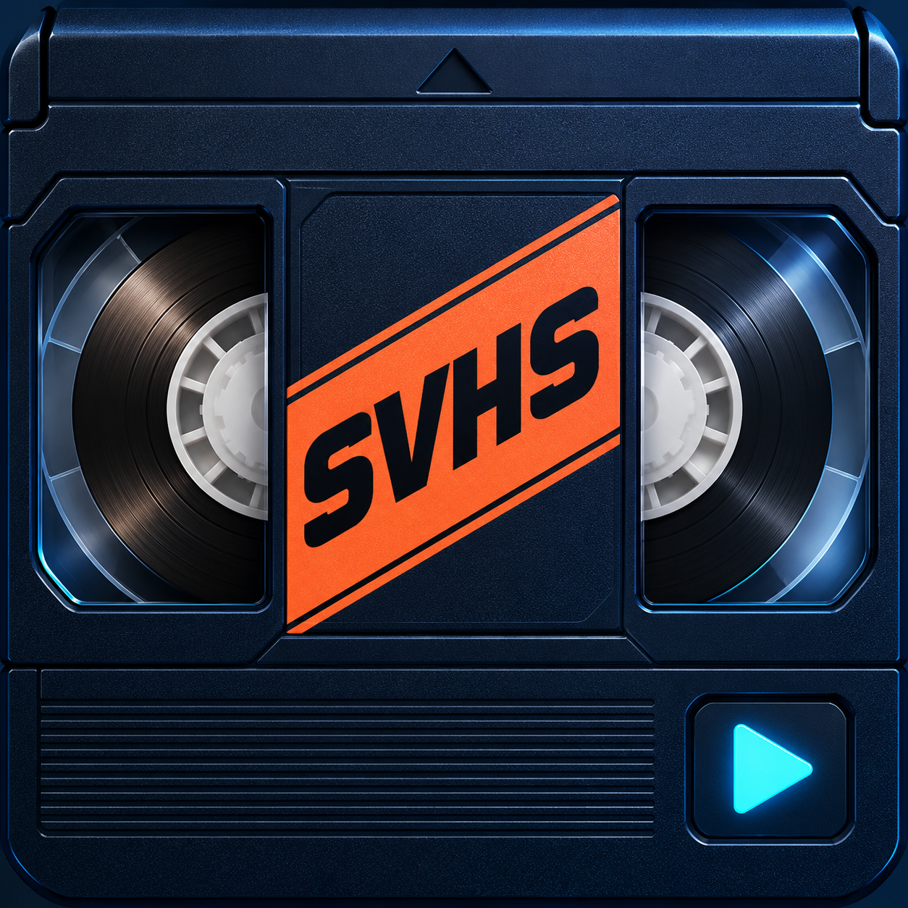

# Intensity Shuttle USB 3.0 driver for Apple Silicon and Mac OS X 27 Golden Gate.

**Capture VHS, play movie files and monitor editing timelines through the Intensity Shuttle USB 3.0 on an Apple-silicon Mac.**

Current software: **0.1.39**. Independent community development project; not an official Blackmagic Design driver and not affiliated with Blackmagic Design, Apple or Adobe.

[Downloads / Releases](https://github.com/andrewvideo/intensity-shuttle-usb-3.0/releases) · [Illustrated user guide](docs/user-guide/Read%20Me.md) · [PDF guide](docs/user-guide/Read%20Me.pdf) · [Build from source](docs/BUILDING.md) · [Release notes](docs/RELEASE-NOTES-0.1.39.md)

> **Read before installing:** this is an experimental development build, tested on one Mac Studio. The installer is unsigned, its components are ad-hoc signed, and it is not notarized. The current installer requires SIP disabled. This weakens macOS protection; it is not a normal consumer installation. Read the [security preparation and restoration instructions](docs/user-guide/Read%20Me.md#security-preparation) first. Building the source does not change security settings.

## What the software does

| Feature | Controls and behaviour |
|---|---|
| VHS capture | PAL/NTSC S-Video or composite input, analog RCA stereo audio and selectable 4:3 capture sizes |
| Live picture controls | Brightness, contrast, colour/saturation and horizontal sharpness while capture continues |
| Signal loss | Hold the last picture or show black while retaining capture timing |
| Editor monitoring | Final Cut Pro A/V Output and a Premiere Pro Mercury Transmit video plug-in |
| Movie playback | Choose a movie, scale it to the selected output format, play its audio and optionally loop it |
| Desktop output | Mirror an existing Mac screen or create an experimental separate extended desktop |
| Fit / Fill / Stretch | Preserve the whole picture, crop to fill, or stretch to the entire output frame |
| Default output screen | Hold, black, colour bars, a picture or a silent looping movie after a configurable idle delay |
| Monitoring aids | Timecode, L/R audio meters, title/action safe guides and adjustable timeline audio sync |

## Capture and adjust a tape

Connect the VCR's video and red/white audio outputs to the Shuttle. In **Capture**, choose the video standard, input, audio source and resolution, then **Apply** with camera previews closed. Record through a camera app such as QuickTime Player; select **Intensity Shuttle — Stereo Audio** as its microphone.

PAL capture offers 720×576 native or 768×576 square pixels. NTSC offers 720×480 native or 640×480 square pixels. Both also offer 1280×960 and 1440×1080 (4:3). Larger sizes are scaled and add no tape detail. Bob deinterlacing gives 50 fps for PAL and approximately 59.94 fps for NTSC.

In **Picture**, enable **Live adjustments** and move the sliders while watching your recording app's preview. **Reset picture** restores neutral settings. These controls process the camera feed; they do not alter the tape.

## Video output and editing apps

Choose **Final Cut Pro**, **Premiere Pro**, **Movie file**, **Mac desktop** or **Extended display** in **Video Output**. Start editor output here and wait for **Ready** before enabling the editor's external output. Keep Shuttle Camera running. Capture and playback share the device: use one at a time.

- **Final Cut Pro:** select the Shuttle in Settings → Playback → A/V Output, then enable Window → A/V Output. **Use Shuttle Audio** routes Mac media sound to the device.
- **Premiere Pro:** enable Mercury Transmit and the Shuttle video stream in Playback settings. Select **Intensity Shuttle — HDMI Audio** separately in Audio Hardware. The Transmit plug-in is video-only.
- **Movie file:** choose a file, select sizing and optionally enable **Loop**. The movie's own sound goes through the Shuttle automatically.

The audio button is named **Use Shuttle Audio** because compatible device outputs can carry sound. The Core Audio device retains its existing HDMI Audio name for compatibility. Stop restores the saved Mac sound route unless you selected another route manually; an explicit Premiere audio selection must be restored inside Premiere.

| Output choice | Wire raster and cadence |
|---|---|
| PAL 576i50 | 720×576, 50 fields/s |
| NTSC 480i59.94 | 720×486, approximately 59.94 fields/s |
| 1080i50 / 1080i59.94 | 1920×1080, 50 / approximately 59.94 fields/s |
| 1080p25 / 1080p29.97 | 1920×1080, 25 / approximately 29.97 frames/s |

Select HDMI, S-Video, composite or component to constrain the available formats. S-Video/composite use PAL or NTSC. Compatible physical outputs may operate simultaneously; connector selection is not an exclusive switch. Simultaneous HD output plus separate SD downconversion is not implemented. Capture settings and video-output timing are independent.

## Desktop and scaling

**Mac desktop** mirrors an existing display. **Extended display** creates a separate screen for windows; arrange it in macOS Displays. Screen-recording permission is required. The virtual display uses an undocumented macOS interface and remains experimental.

PAL/NTSC start with a 1024×768 desktop scaled into the selected SD output. HD starts with 1920×1080. macOS may offer further desktop resolutions. Choose **Stretch before starting output** to map the whole current desktop onto the video frame and follow resolution changes live. All eleven requested desktop sizes from 800×600 through 1920×1080, including 1600×1200, passed the software scaling tests. This does not add 4K or 1080p50/60 wire output.

**Fit** preserves proportions with borders. **Fill** preserves proportions by cropping. **Stretch** changes proportions to fill the frame. Restart Fit/Fill after changing the desktop resolution. Stop removes the extended screen.

## Idle screen, timecode and meters

The **Idle Screen** tab chooses what to show when no new editor frames arrive. The default wait is two minutes; choose Immediately, 30 seconds, 1/2/5/10 minutes or Never. Playback or scrubbing restores the editor picture. Restart output after changing idle media or sizing. A movie idle screen loops silently.

Timecode and L/R meters have independent positions in six locations. The timecode starts with **TC** and has a translucent background. Title-safe and action-safe guides are optional. Negative audio-sync values move timeline sound earlier; positive values delay it. These are output-monitoring controls, not changes to the editor project or capture file.

## Requirements and current limits

- Intensity Shuttle **USB 3.0**, a working USB 3 connection, an Apple-silicon Mac and administrator access.
- The supplied package requires **macOS 27 or later**; the tested system is a Mac Studio on macOS 27.0.1. Other Macs/releases are not comprehensively qualified. Intel and Thunderbolt Shuttle support are not included.
- Tested editor integrations: Final Cut Pro 11 and Premiere Pro 2025. Adobe's C++ SDK is needed only to rebuild its plug-in and is not redistributed here.
- Capture is standard-definition. Listed component/HDMI input choices do not establish HD capture support. Output is limited to the formats above; there is no DaVinci Resolve output integration or selectable RGB HDMI mode.
- PAL composite playback and composite/S-Video capture passthrough were confirmed on the tested setup. Component playback and every NTSC analogue combination are not newly qualified by that test.
- Exact long-session latency, every codec/4K timeline workflow and fresh-machine installation remain outside comprehensive qualification. For choppy playback, compare A/V Output off/on and match timeline/output cadence before assuming a driver regression.

## Install, troubleshoot or contribute

Use the [current illustrated guide](docs/user-guide/Read%20Me.md) for installation, camera-extension approvals, audio, screen-recording permission recovery, troubleshooting and removal. The [PDF](docs/user-guide/Read%20Me.pdf) and self-contained [HTML copy](docs/user-guide/Read%20Me.html) cover the same software version. Use a release asset when available; source-code ZIP downloads are not installers.

Developers can [build and modify the complete source](docs/BUILDING.md). See [build validation](BUILD-VALIDATION.md), [release preparation](RELEASING.md) and the [publisher checklist](Publisher%20checklist.md). Preserve GPL/LGPL notices and corresponding source when redistributing; Adobe SDK terms apply separately. See [third-party notices](THIRD-PARTY-NOTICES.md).

Screenshots are rendered from the current native app views with demonstration settings. They contain no personal recordings; selected values are examples, not promised defaults. The original SVHS project icon is included under the project licence. Older restricted icon-pack artwork must not be reintroduced.
