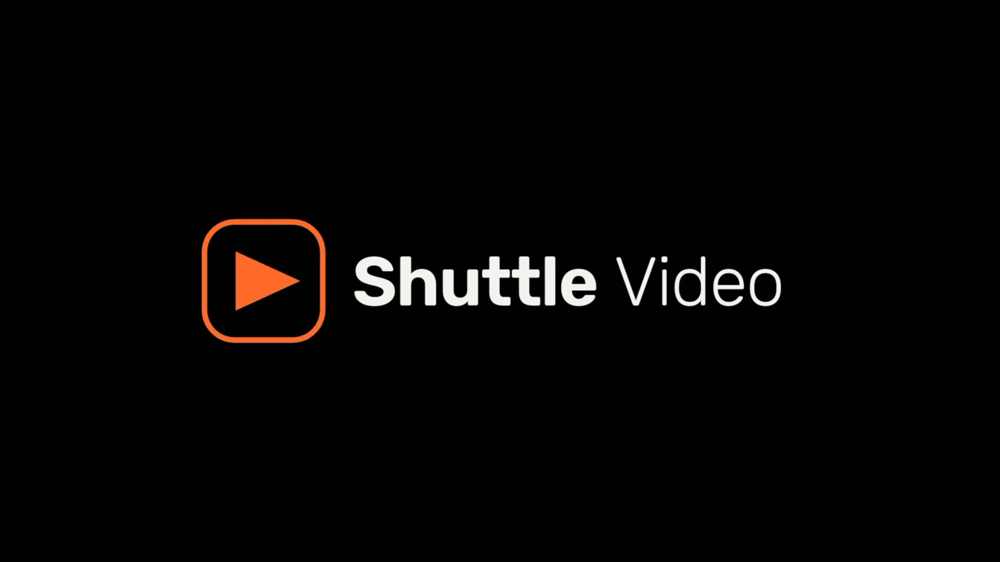
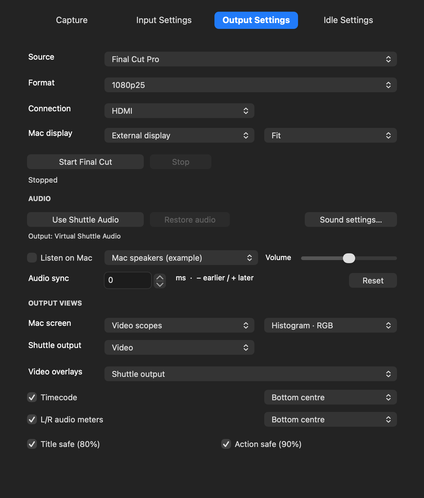
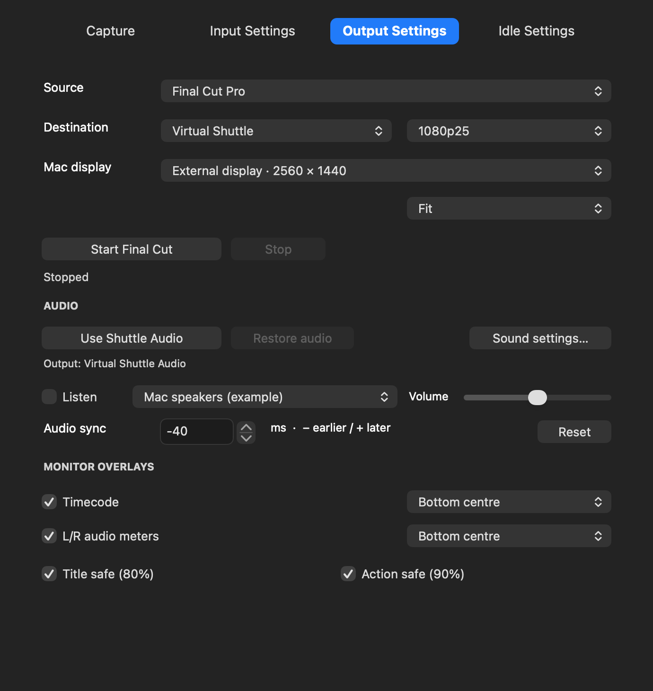
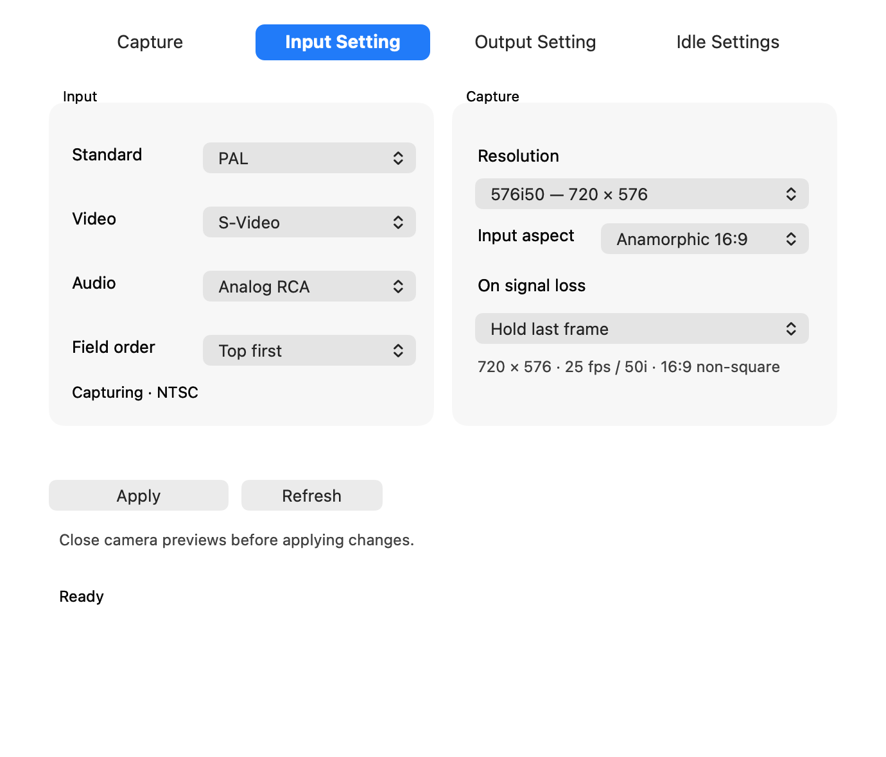
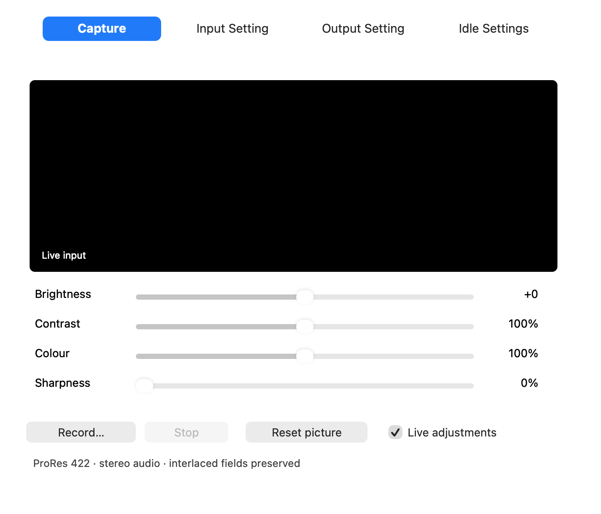
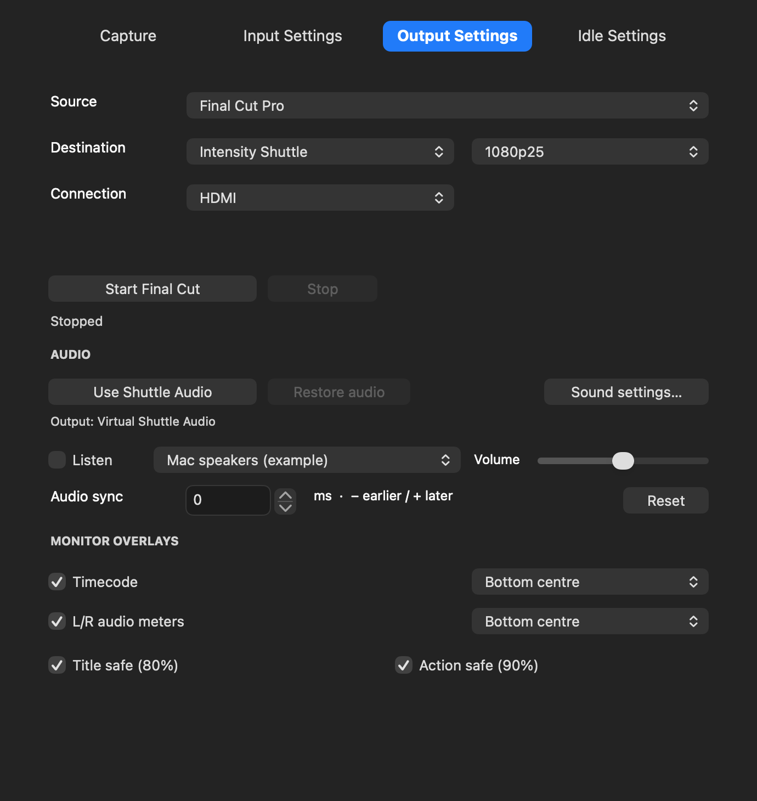

# Shuttle Video + Shuttle Player

Capture VHS, record with a choice of codecs, play movies and monitor editing timelines on an Intensity Shuttle USB 3.0 or a chosen Mac display.

**Shuttle Video 0.1.54 + Shuttle Player 0.3.2 — experimental development release.** Capture, editor monitoring and movie/web-video playback in one project. Shuttle Video was formerly Shuttle Camera. Independent community project; not affiliated with Blackmagic Design, Apple, Adobe or the supported video sites.

[Download both apps](https://github.com/andrewvideo/intensity-shuttle-usb-3.0/releases/tag/v0.1.54-player-0.3.2) · [What’s new](docs/Whats-New-Player-0.3.2.md) · [User guide](docs/user-guide/Read%20Me.md) · [Build from source](docs/BUILDING.md)

> The installer is unsigned, components are ad-hoc signed and not notarized, and the development extensions require SIP disabled. This weakens macOS protection. Read the [security preparation and restoration instructions](docs/user-guide/Read%20Me.md#security-preparation) before installing. The installer never changes security settings. macOS 14.4+ is the build target; Apple silicon is the tested platform. Intel binaries are included but Intel/older macOS runtime is untested.

## Two apps, one download

| App | Use it for |
|---|---|
| **Shuttle Video 0.1.54** | VHS capture, picture controls, Final Cut/Premiere monitoring, scopes and desktop output. |
| **Shuttle Player 0.3.2** | Local movies and public YouTube, Dailymotion or Vimeo videos through the Shuttle, with playback controls and Stretch. |

The **Complete ZIP** contains the full **Shuttle Video 0.1.54 installer**, **Shuttle Player.app**, illustrated guides and the complete matching source ZIP. Install the main package for capture/editor features; copy Player to Applications separately. The installer does not install Player. Existing 0.1.54 users only need to replace Player; the main app, drivers and editor plug-ins are unchanged. Both apps are developed here: [main source](docs/BUILDING.md) and [Player source/build instructions](player/README.md).

## Play web videos through the Shuttle

In **Shuttle Player**, select your connection and output format, then choose **File → Open Video URL… (⇧⌘O)**. Paste a YouTube, Dailymotion or Vimeo link and choose **Open and Play**. The URL box opens from the File menu only.

| Method | When to use it | Controls |
|---|---|---|
| **Download first** | Prepares the whole video before playback. Best for reliable seeking, looping and replay. | Play/Pause, Stop, scrub, ±10 seconds, Loop and volume. |
| **Stream** | Starts after about three seconds of picture/audio buffering, while the rest arrives. Site lookup adds startup time. | Play/Pause, Stop, scrub, ±10 seconds and volume. Use Download first for Loop. |

**Stream and scrub:** drag the slider and release to jump, or use the ten-second skip buttons. Picture holds with silence while the new position buffers; a paused seek stays paused and a playing seek resumes. Expect a short wait after a jump. Buffering progress is shown. The updated YouTube reader uses bounded requests to reduce repeated rebuffering; a slow connection can still stall. Reopen the original URL if a stream link expires.

Picture and stereo sound go directly to the Shuttle, with **Stretch** selected by default; Fit and Fill are available. Player initially uses Shuttle Video’s saved PAL/NTSC/output connection. Local movies use **File → Open Video… (⌘O)** and wait for Play. Stop releases USB. Capture and physical playback share one device, so close other camera/editor output clients first.

*Actual Player controls with an original synthetic test movie. The screenshot illustrates local playback; web playback uses the same transport.*

Only compatible **public on-demand** videos are supported. Sign-in/password-only videos, DRM, live/upcoming broadcasts and every possible site format are outside support. No browser cookies or account credentials are read. Use videos you have permission to play. Download first caches its prepared movie until replacement or normal quit; Stream keeps a bounded RAM buffer rather than the whole movie. No user Homebrew/Python installation is needed. [Player guide and limits](player/README.md) · [Test results](player/VALIDATION.md).

Player is ad-hoc signed and not notarized, targets macOS 13+, and includes both architectures; Intel/older macOS runtime is untested. Replacing Player does not change drivers or security settings. Software tests cover public-site decoding/seeking, sync fixtures and sustained delivery; the new 0.3.2 streaming seek workflow still needs a physical HDMI user check. Earlier local-file HDMI playback and basic 0.3.0 URL output were user-confirmed. This is experimental software, not a guarantee that every link or Mac works.

## Startup logo

Opening Shuttle Video plays the bundled **5.64-second startup movie** on an idle Shuttle at the saved output format, stretched to the output frame, then **holds its final logo**. Any app control/menu action stops the startup sender and waits for USB release before continuing. The movie’s sound goes to the Shuttle; it is silent after the end. No Mac sound route is changed. Busy capture/output is left alone. Turn off **Idle Settings → Play startup video on Shuttle** to disable it next time.

The main app’s startup behaviour is unchanged in this companion release. [Shuttle Video 0.1.54 instructions](docs/Whats-New-0.1.54.md).

## Fullscreen Mac monitor

Virtual Shuttle now covers the whole selected display, including the menu-bar and Dock area, while Final Cut keeps its normal editing screen and keyboard focus. Click the monitor then press Escape, right-click → Stop Virtual Shuttle, or click Stop in Shuttle Video to end output. In paired mode this stops both destinations. [Fullscreen guide](docs/Whats-New-0.1.52.md).

## Simultaneous outputs and scopes

In **Output Settings**, choose **Final Cut Pro** or **Premiere Pro**, then set these two menus independently:

| Menu | Choices |
|---|---|
| Mac screen | Video / Video scopes / Off |
| Shuttle output | Video / Video scopes / Off |

For scopes on the HDMI TV, choose **Shuttle output → Video scopes**. You can show scopes on both outputs, video on both, or split them. When Scopes is selected, a second menu chooses Four up, Luma waveform, RGB parade, RGB overlay, Vectorscope or RGB histogram. Scope views never show timecode, audio meters or safe guides. **Video overlays** edits those saved options for a selected Video output only.

Video/Scopes and scope style can change live. Disable editor external output and click **Stop** before changing an output to/from Off. Off stops that destination's sender; it does not electrically switch off a physical connector. Both Off disables Start. See the [illustrated setup guide](docs/Whats-New-0.1.53.md).

Scopes measure the pre-overlay 8-bit SDR feed (Rec.709 HD / Rec.601 SD). Version 0.1.51 adds higher-detail waveform analysis and native RGB Mac-display scopes, up to 3840×2160. Scope views automatically omit timecode, meters and safe guides; those saved choices return in Video view. Analysis and drawing run on a coalescing background worker, following the selected 25/29.97 fps output cadence when rendering keeps up, without making USB playback wait. This is an experimental software monitor, not HDR/calibrated instrumentation. New routing/startup behaviour still needs a live check on the released build; see the validation notes. [Scope update and audio routing](docs/Whats-New-0.1.50.md).

## Final Cut: two output devices

In **Output Settings**, choose **Final Cut Pro**, set both output menus and select a format matching your timeline. If Mac screen is on, choose the target Mac display.

- **Mac screen on** (alone or together with Shuttle): select **Virtual Shuttle** in Final Cut.
- **Mac screen Off / Shuttle output on**: select **Intensity Shuttle — HDMI Output** in Final Cut.

Click **Start Final Cut** and wait for Ready before choosing that device in Final Cut's **Settings → Playback → A/V Output**, then enable **Window → A/V Output**. Keep Shuttle Video open. With both destinations on, a single Virtual Shuttle feed is duplicated inside the app. Mac-only output does not open USB or require screen-recording permission.

Both devices receive Final Cut's rendered video, including effects, colour corrections and titles, during playback and when Final Cut supplies an updated paused frame. Select a mode matching the project frame rate. Virtual display output offers Fit / Fill / Stretch. Output overlays are added for monitoring and do not alter the timeline or exported movie.

*Illustration of the actual app controls with example devices; live Final Cut integration remains to be checked on the installed build.*

**Audio:** click **Use Shuttle Audio** to route editor sound through **Virtual Shuttle Audio**. This feeds the L/R meters even with **Listen on Mac** off. To hear it locally, enable **Listen on Mac**, choose speakers/headphones and set the listening volume. This volume does not change meter levels or outgoing Shuttle audio. Stop restores the saved normal media output unless you have since chosen another route. Virtual and hardware audio-sync offsets are saved separately.

## What the software does

| Feature | Controls and behaviour |
|---|---|
| VHS capture | PAL/NTSC S-Video or composite input, analog RCA stereo audio and selectable 4:3 capture sizes |
| Live picture controls | Brightness, contrast, colour/saturation and horizontal sharpness while capture continues |
| Signal loss | Hold the last picture or show black while retaining capture timing |
| Editor monitoring | Two Final Cut A/V devices: Virtual Shuttle for a Mac display and Intensity Shuttle for hardware; Premiere Mercury Transmit for Mac display, hardware or both |
| Movie playback | Choose a movie, scale it to the selected output format, play its audio and optionally loop it |
| Desktop output | Mirror an existing Mac screen or create an experimental separate extended desktop |
| Fit / Fill / Stretch | Preserve the whole picture, crop to fill, or stretch to the entire output frame |
| Default output screen | Hold, black, colour bars, a picture or a silent looping movie after a configurable idle delay |
| Monitoring aids | Timecode, L/R audio meters, title/action safe guides and adjustable timeline audio sync |

## Capture and adjust a tape

Connect the VCR's video and red/white audio outputs to the Shuttle. In **Input Settings**, choose the standard, inputs, resolution and aspect, then **Apply** with other camera previews closed.

Open **Capture** and click **Show input**, allowing Camera access when macOS asks, for the live preview and Brightness, Contrast, Colour and Sharpness. Click **Record…** to save a ProRes 422 MOV with Shuttle stereo audio, then **Stop** and wait for **Saved**. Interlaced presets preserve both fields and their order; progressive presets stay progressive. Recording continues if you visit another tab. See the [recording guide and validation limits](docs/Whats-New-0.1.42.md).

Native interlaced PAL is 720×576, 25 frames / 50 fields; NTSC is 720×480, approximately 29.97 frames / 59.94 fields. Select 4:3 or anamorphic 16:9 independently. Square-pixel and 720p/1080p progressive upscales remain available, alongside 1080i. Upscaling adds no tape detail. QuickTime and other camera applications remain usable, but their recording paths may alter interlace metadata; use the app's direct recorder when retaining fields is required.

## Video output and editing apps

Choose **Final Cut Pro**, **Premiere Pro**, **Movie file**, **Mac desktop** or **Extended display** in **Output Settings**. Start editor output here and wait for **Ready** before enabling the editor's external output. Keep Shuttle Video running. Capture and physical playback share the device: use one at a time. Mac-only output does not open USB. Turn both output menus on for simultaneous monitoring.

- **Final Cut Pro:** select the Shuttle in Settings → Playback → A/V Output, then enable Window → A/V Output. **Use Shuttle Audio** routes Mac media sound to the device.
- **Premiere Pro:** select the two output views, click **Start Premiere**, wait for Ready, then enable Mercury Transmit and **Intensity Shuttle — HDMI Output** in Playback settings. This same existing plug-in supplies Mac-only, Shuttle-only or both destinations. In Audio Hardware choose **Virtual Shuttle Audio** for sound and metering. The Transmit plug-in is video-only; **Listen on Mac** adds local speakers/headphones.
- **Movie file:** choose a file, select sizing and optionally enable **Loop**. The movie's own sound goes through the Shuttle automatically.

The audio button is named **Use Shuttle Audio** because compatible device outputs can carry sound. The output Core Audio device is named **Virtual Shuttle Audio** (older versions used an HDMI Audio name). Stop restores the saved Mac sound route unless you selected another route manually; an explicit Premiere audio selection must be restored inside Premiere.

| Output choice | Wire raster and cadence |
|---|---|
| PAL 576i50 | 720×576, 50 fields/s |
| NTSC 480i59.94 | 720×486, approximately 59.94 fields/s |
| 1080i50 / 1080i59.94 | 1920×1080, 50 / approximately 59.94 fields/s |
| 1080p25 / 1080p29.97 | 1920×1080, 25 / approximately 29.97 frames/s |

Select HDMI, S-Video, composite or component to constrain the available formats. S-Video/composite use PAL or NTSC. Compatible physical outputs may operate simultaneously; connector selection is not an exclusive switch. Simultaneous HD output plus separate SD downconversion is not implemented. Capture settings and video-output timing are independent.

## Desktop and scaling

**Mac desktop** mirrors an existing display. **Extended display** creates a separate screen for windows; arrange it in macOS Displays. Screen-recording permission is required. The virtual display uses an undocumented macOS interface and remains experimental.

PAL/NTSC start with a 1024×768 desktop scaled into the selected SD output. HD starts with 1920×1080. macOS may offer further desktop resolutions. Choose **Stretch before starting output** to map the whole current desktop onto the video frame and follow resolution changes live. All eleven requested desktop sizes from 800×600 through 1920×1080, including 1600×1200, passed the software scaling tests. This does not add 4K or 1080p50/60 wire output.

**Fit** preserves proportions with borders. **Fill** preserves proportions by cropping. **Stretch** changes proportions to fill the frame. Restart Fit/Fill after changing the desktop resolution. Stop removes the extended screen.

## Idle screen, timecode and meters

The **Idle Settings** tab chooses what to show when no new editor frames arrive. The default wait is two minutes; choose Immediately, 30 seconds, 1/2/5/10 minutes or Never. Playback or scrubbing restores the editor picture. Restart output after changing idle media or sizing. A movie idle screen loops silently.

Timecode and L/R meters have independent positions in six locations. The timecode starts with **TC** and has a translucent background. Title-safe and action-safe guides are optional. Negative audio-sync values move timeline sound earlier; positive values delay it. These are output-monitoring controls, not changes to the editor project or capture file.

## Requirements and current limits

- Intensity Shuttle **USB 3.0** and USB 3 connection for hardware capture/playback; Virtual Shuttle needs no USB device. Administrator access is needed to install the drivers.
- The supplied universal package targets **macOS 14.4 or later**. The tested platform is an Apple-silicon Mac Studio on macOS 27.0.1. Intel and older macOS runtime are untested. The Thunderbolt Shuttle is not supported.
- Tested editor integrations: Final Cut Pro 11 and Premiere Pro 2025. Adobe's C++ SDK is needed only to rebuild its plug-in and is not redistributed here.
- Capture is standard-definition. Listed component/HDMI input choices do not establish HD capture support. Output is limited to the formats above; there is no DaVinci Resolve output integration or selectable RGB HDMI mode.
- PAL composite playback and composite/S-Video capture passthrough were confirmed on the tested setup. Component playback and every NTSC analogue combination are not newly qualified by that test.
- Exact long-session latency, every codec/4K timeline workflow and fresh-machine installation remain outside comprehensive qualification. For choppy playback, compare A/V Output off/on and match timeline/output cadence before assuming a driver regression.

## Install, troubleshoot or contribute

Use the [current illustrated guide](docs/user-guide/Read%20Me.md) for installation, camera-extension approvals, audio, screen-recording permission recovery, troubleshooting and removal. The [PDF](docs/user-guide/Read%20Me.pdf) and self-contained [HTML copy](docs/user-guide/Read%20Me.html) cover the base workflows; see the 0.1.40 capture note above for the added controls. Use a release asset when available; source-code ZIP downloads are not installers.

Developers can [build and modify the complete source](docs/BUILDING.md). See [build validation](BUILD-VALIDATION.md), [release preparation](RELEASING.md) and the [publisher checklist](Publisher%20checklist.md). Preserve GPL/LGPL notices and corresponding source when redistributing; Adobe SDK terms apply separately. See [third-party notices](THIRD-PARTY-NOTICES.md).

Screenshots are rendered from the current native app views with demonstration settings. They contain no personal recordings; selected values are examples, not promised defaults. The original SVHS project icon is included under the project licence. Older restricted icon-pack artwork must not be reintroduced.
