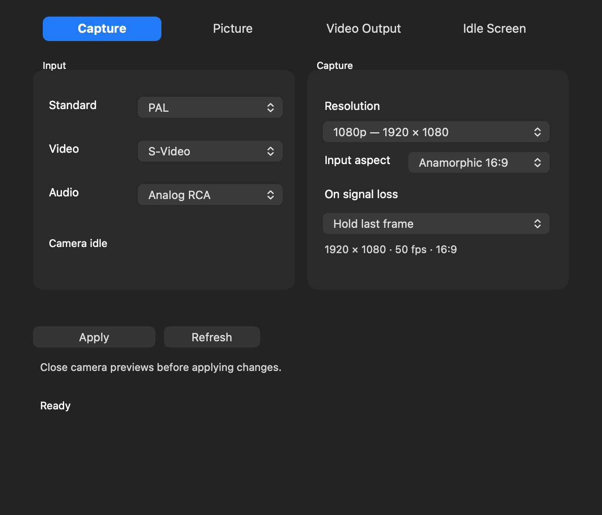

# Shuttle Camera 0.1.40 - widescreen and HD capture sizes

The Capture tab now has **Input aspect: 4:3 / Anamorphic 16:9** and **720p / 1080p** resolution choices. These process the camera feed used by QuickTime and other camera clients. Physical USB input remains SD; upscaling adds no source detail. This does not add HDMI playback formats or change editor output.

## Choose the correct shape

- Use **4:3** for ordinary VHS and other standard-shaped pictures.
- Use **Anamorphic 16:9** for a widescreen source carried as a horizontally squeezed SD picture. It is not a zoom that removes letterbox bars from a 4:3 recording.
- Native keeps 720x576 PAL or 720x480 NTSC and reports the selected pixel aspect ratio. Some recording apps may ignore or discard native pixel-aspect metadata; square-pixel capture is more portable.
- Square pixels gives PAL 768x576 / NTSC 640x480 for 4:3, or PAL 1024x576 / NTSC 854x480 for 16:9. The even NTSC width is a close approximation to 853 1/3 pixels.
- **720p** is 1280x720; **1080p** is 1920x1080. Anamorphic 16:9 fills these frames; 4:3 uses centred black side bars without stretching or cropping.
- Existing 1280x960 and 1440x1080 choices remain. They preserve a widescreen selection with top/bottom bars.

All scaled outputs use square pixels. PAL remains 50 progressive frames/s; NTSC remains approximately 59.94 progressive frames/s, produced by the existing bob deinterlacer. There is no 720i or interlaced camera mode. The recorder chooses its codec; these controls do not encode a DV file.

## Install and use

1. Stop capture/output and quit camera apps, editors and Shuttle Camera. Install Shuttle-Capture-0.1.40.pkg on the startup volume.
2. Open Shuttle Camera from Applications. With camera previews closed, choose **Help > Driver Setup > Enable Camera** to activate the updated camera extension (18). Approve it in Camera Extensions if macOS requests that.
3. In Capture, choose PAL/NTSC, the matching video/audio inputs, Input aspect and Resolution. Click **Apply** with all camera previews closed.
4. Reopen QuickTime or the camera client. Select the Shuttle camera and the separate **Intensity Shuttle - Stereo Audio** microphone. Make a short recording and check its shape, dimensions, motion and sound.
5. Apply saves the settings; Refresh reads the active camera settings. Picture controls continue working live. Input/aspect/resolution changes require closing camera clients first.

Old settings without an aspect key default to 4:3. Existing resolution strings/indices remain compatible. The new host refuses to apply capture settings to an older camera extension and explains how to activate the update.

Host40 / camera18. Output12, HAL3 and Premiere1 are unchanged. The existing experimental unsigned/ad-hoc signing setup, SIP-disabled requirement and base installation/removal guide still apply. The illustrated 0.1.39 guide covers the unchanged workflows; use this note for the new capture controls.

## Validation

PAL/NTSC x two input aspects x six output sizes passed guarded UYVY resampling checks, including luma/chroma separation, borders and row padding. All 24 actual camera CVPixelBuffer paths and CMIO format descriptions passed dimension, pixel-aspect, black-frame and frame-duration checks. Native samples remain unchanged. Existing live-picture fixture and isolated UI tests passed without real USB, preference, audio or helper actions. Installer mock/payload/signature checks run during packaging. Long live recordings and third-party recorder metadata retention still need user testing after installation.
