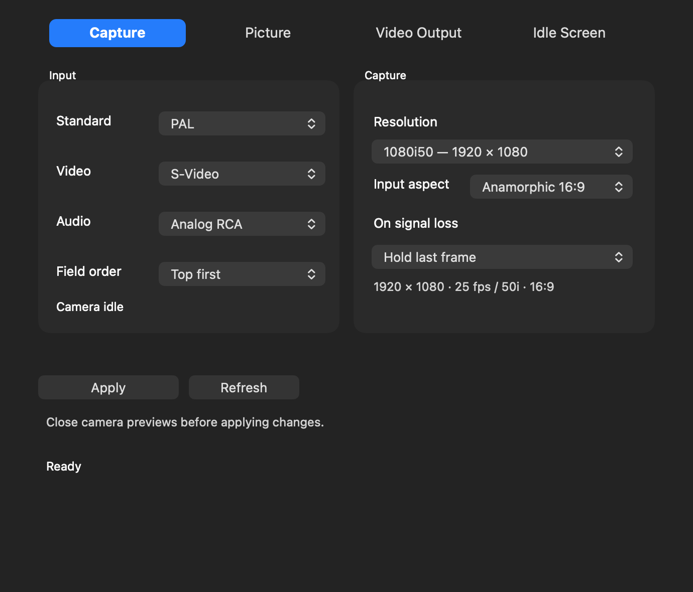

# Shuttle Camera 0.1.41 - field-preserving interlaced capture

Capture now includes separate **576i50 / 480i59.94** and **1080i50 / 1080i59.94** resolution choices, plus **Field order: Top first / Bottom first**. The current 0.1.40 progressive upscales and 4:3 / anamorphic 16:9 options remain.

| Capture preset | PAL | NTSC | Frame contents |
|---|---|---|---|
| Native progressive (existing) | 720x576, 50p | 720x480, 59.94p | One bob-deinterlaced picture per field |
| Native interlaced (new) | 720x576, 576i50 | 720x480, 480i59.94 | Two original fields per frame |
| 720p upscale (existing) | 1280x720, 50p | 1280x720, 59.94p | Bob-deinterlaced, square pixels |
| 1080p upscale (existing) | 1920x1080, 50p | 1920x1080, 59.94p | Bob-deinterlaced, square pixels |
| 1080i upscale (new) | 1920x1080, 1080i50 | 1920x1080, 1080i59.94 | Fields scaled separately, then interleaved |

50i means 50 fields carried in 25 frames per second. 59.94i means approximately 59.94 fields in 29.97 frames per second. There is no 720i preset. Native PAL/NTSC input remains SD; upscaling adds no source detail. This changes the camera feed, not the physical HDMI output modes.

## Installation and use

1. Stop capture/output and quit camera apps, editors and Shuttle Camera before installing Shuttle-Capture-0.1.41.pkg.
2. Open Shuttle Camera. With previews closed, choose Help > Driver Setup > Enable Camera to activate camera extension 19. Approve Shuttle Camera Extension in Camera Extensions if requested. Output12/HAL3/Premiere1 stay unchanged.
3. Quit and reopen Shuttle Camera and the recording app after activation so their camera registrations refresh. If Apply says an update is needed, verify extension 19 is active rather than reinstalling repeatedly.
4. Choose PAL/NTSC, video/audio inputs, the interlaced Resolution and Input aspect. Field order is enabled only for the new interlaced choices. Click Apply with previews closed.
5. Record a short sample. Select the separate Stereo Audio microphone where required. Inspect the saved file's dimensions, field metadata and motion in a field-aware editor before committing to a long recording.

Native interlaced capture retains the original 720-pixel raster and reports 4:3 or 16:9 pixel aspect. 1080i is square-pixel HD: anamorphic 16:9 fills the frame; 4:3 retains side bars. Each field is resized independently so the filter never mixes different motion instants. Top first places the first captured temporal field on the top rows; Bottom first places it on the bottom rows and changes the reported dominance accordingly. The choice is not automatically inferred from a DV codec because the Shuttle input is analogue/raw SD capture.

The driver reports two fields and their interleaved spatial order using [Apple's Core Video field metadata](https://developer.apple.com/documentation/corevideo/image-buffer-field-detail-constants). A recording app may deinterlace, convert, or discard that metadata. Interlaced camera output does not guarantee an interlaced encoded file from every recorder. QuickTime and other recording applications still choose the file codec; this update is not DV encoding. A non-deinterlacing progressive preview may show combing on motion even when field preservation is correct.

Picture controls remain live. Changing resolution, aspect or field order requires closing camera previews. Independent audio clock and dropout hold/black timing continue at the selected sample cadence. Old settings default to the previous progressive mode; omitted new field-order settings retain the current value.

## Validation and status

In-memory tests use deliberately different first/second fields for PAL and NTSC, in both separated USB field blocks and interleaved input layouts. Both input aspects, both field orders and native/1080i passed actual camera-buffer checks with no cross-field blending. Native field bytes are preserved exactly; output row padding and guard bytes are untouched. Actual intercepted CMIO sample delivery verifies 25 / 29.97 fps timestamps and durations, field metadata and unchanged progressive cadence. Stream property durations agree with advertised format durations. Settings, native UI, existing progressive scaler and installer tests also pass. No USB capture, audio route or production preference is changed by those fixtures.

Live recorder compatibility, physical source field dominance and saved-file field tags require checking after installation. The user has confirmed 0.1.40 progressive 1080p / 16:9 capture looks correct; this does not qualify the new interlaced path. The experimental signing/security setup remains unchanged.
