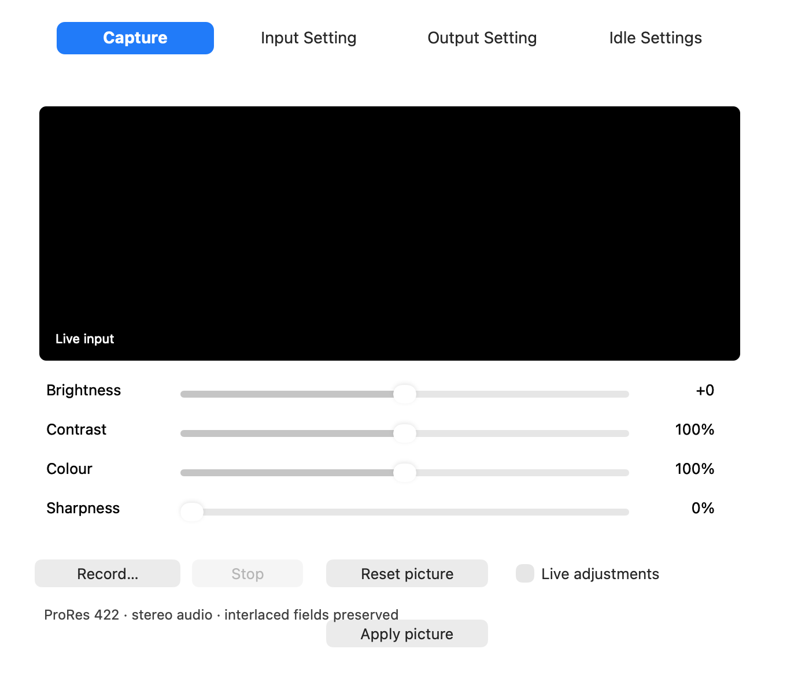

# Shuttle Camera 0.1.43 — capture permission and startup repair

## What changed

macOS refused the 0.1.42 app's direct camera access because its bundle omitted `NSCameraUsageDescription`. Command-line tests used a different permission context and did not catch the installed-app failure. This repair adds camera and microphone usage descriptions, requests consent before using the corresponding input, and reports denied permissions clearly.

Opening the app no longer starts USB capture automatically. On Capture, click **Show input** (or select Capture explicitly) to start the live preview. **Stop preview**, or selecting another tab, releases that preview's camera reference. Recording remains independent until Stop. This prevents simply opening the settings app from switching the Shuttle away from playback. The four-tab layout is unchanged.

The recorder also accepts normal sub-nanosecond rounding between NTSC rational frame durations and the camera's nanosecond timestamps. It still rejects genuinely backwards video timing. The final audio sample is trimmed to fit completely within the video timeline.

## Install and check

1. Stop capture/output and close camera previews, editors and Shuttle Camera. Install **Shuttle-Capture-0.1.43.pkg** using the Mac administrator prompt.
2. Open Shuttle Camera. Opening alone leaves capture stopped. No driver reactivation is needed when updating the already enabled 0.1.41/42 setup: camera19 / output12 / HAL3 / Premiere1 are unchanged.
3. In **Capture**, click **Show input** and choose **Allow** when macOS asks for Camera access. Record also requests Microphone access for Shuttle stereo audio. If denied previously, enable Shuttle Camera in System Settings > Privacy & Security > Camera / Microphone, then reopen the app.
4. Confirm the live picture and record a short movie with sound, click Stop and wait for Saved. Check both field preservation and A/V sync before a long recording.
5. For playback, stop recording and choose **Output Setting**. Close other camera previews, choose the existing source/mode and Start. Capture and playback share the USB hardware.

These are ordinary macOS input permissions; the repair does not require additional SIP/security changes. Development signing and first-install requirements remain as documented.

## Hardware check and remaining uncertainty

After the reported scrambled picture, a separate 1080p25 HDMI colour-bar/moving-block test was stable on the user's TV and completed without USB packet/transfer errors. No playback protocol, output extension or output mode has changed in this repair. Input settings were restored to PAL / S-Video after a temporary diagnostic test.

The raw USB input diagnostic reported NTSC timing while PAL was selected. That does not establish why the source and decoder disagree, and this repair does not force a permanent standard change. The preview now displays a detected/selected-standard mismatch instead of hiding it. A live check after Camera permission is still needed to resolve any remaining input/HDMI passthrough problem. Physical recording sound/sync and long HD software-encoding performance remain unqualified.

## Validation

Actual encode/decode tests pass 16 PAL/NTSC SD/HD, top/bottom order, progressive/interlaced combinations using nanosecond-quantized camera timestamps. Tests retain separate fields, stereo PCM and proper cadence; storage/format/timing error handling remains covered. Core Image preview aspect tests and native UI Stop/Quit/startup checks pass. Installer guards now reject bundles missing either required privacy description, in addition to exact version/helper/signature checks. Private tape samples are excluded.
