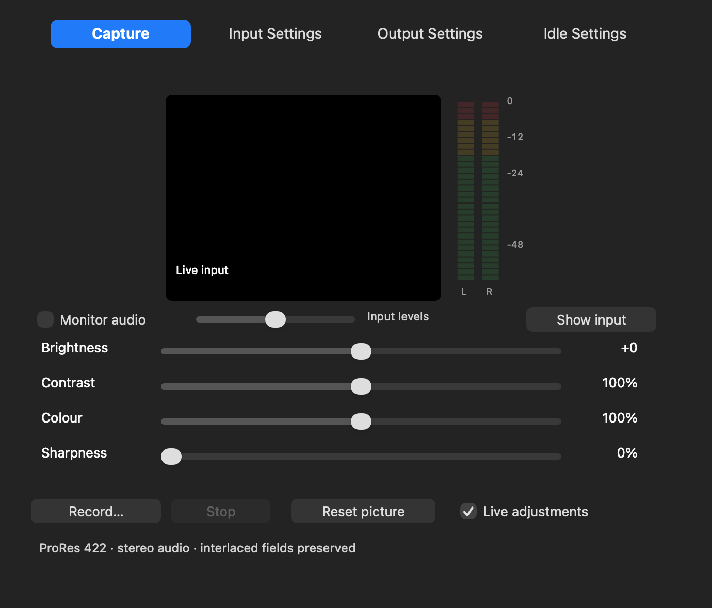
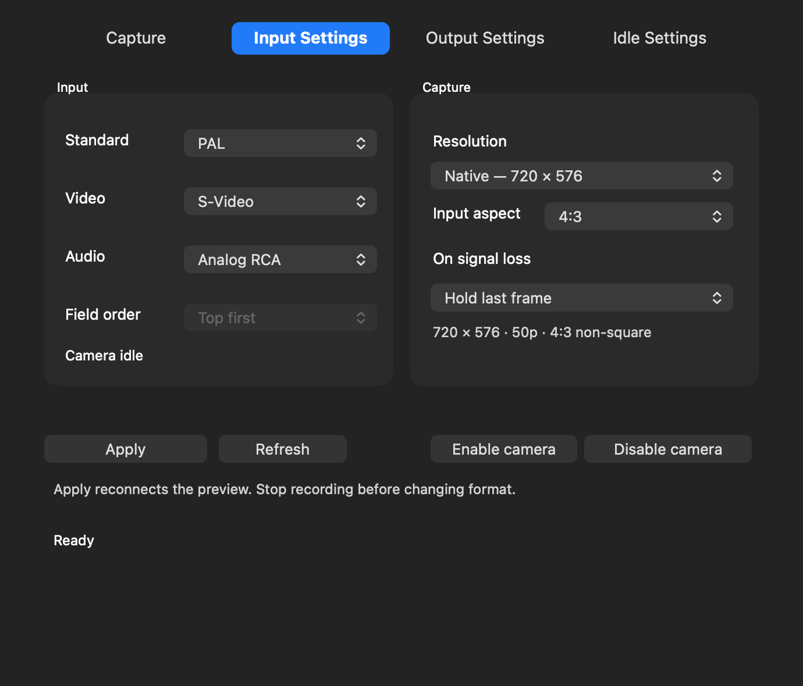

# Shuttle Camera 0.1.46

The Capture tab now has vertical L/R input meters and optional local audio monitoring. Input Settings and Output Settings use the corrected tab names.

## Apply settings without reopening the app

Choose the input standard, connector, resolution and aspect in **Input Settings**, then click **Apply**. The app pauses its own preview, saves the format and reconnects the camera. Return to Capture to see the selected format. The preview border follows the display aspect (including non-square PAL/NTSC pixels), and the meters stay next to it. The whole image is shown without cropping.

Stop an active recording before changing its format. If QuickTime or another camera app is using the Shuttle, close that app's camera preview and click Apply again. Picture sliders remain live and do not require a format reconnect.

## Listen while previewing or recording

Click **Show input**, allow Microphone access if requested, and play the source. The L/R meters show input peaks in dBFS. Enable **Monitor audio** and use the adjacent **listening volume** slider to listen through the current Mac sound output. It starts off when the app opens.

The listening volume changes only the local monitor sound. It does not change the Shuttle's input level, the recorded audio, or the input meters. Moving it to zero or turning monitoring off does not mute the recording. Monitoring has buffering latency and is not a reference for checking recorded lip-sync.

If the Mac sound output is set to the Shuttle's HDMI Audio device, choose speakers, headphones or another local output in macOS Sound settings before monitoring. The app avoids feeding the captured sound back to the Shuttle output. It does not change your Mac's sound output or any device input volume.

## Enable or disable drivers

**Input Settings → Disable camera** removes the camera extension through macOS. Stop recording and close other camera previews first. **Enable camera** requests it again; macOS may ask for approval. The app also offers **Help → Driver Setup → Disable Output Driver**. Stop output and disable editor external playback before using it. macOS may require a restart to finish deactivation. The separate stereo audio component remains installed.

## Send the idle screen directly

In **Output Settings → Source**, choose **Idle screen**, select the output connector/format, and click **Start output**. This shows the screen selected in **Idle Settings** continuously without waiting for the editor timeout. Black, colour bars, a picture and a silent looping movie use the same sizing options. Hold last frame shows black when this source has no previous editor frame. Stop/start output after changing idle media or its sizing; the app can stay open.

The existing editor idle delay still works when Final Cut or Premiere is selected. Stop capture before starting USB output.

## Installation and checks

Stop recording/output and quit camera apps, editors and Shuttle Camera before installing Shuttle-Capture-0.1.46.pkg. Camera extension19, output extension12, stereo audio3 and Premiere plug-in1 stay unchanged; no reactivation is required for those already enabled versions.

The offline checks cover Apply success/failure/external-client blocking and recording protection, preview geometry, independent listening gain/mute and input meter levels, exact idle output framing across all six modes, editor sender startup, UI layout and installer guards. Actual listening on your chosen speakers/headphones and a short recording with sound still need a live check after installation. Existing development signing/security requirements remain unchanged.
