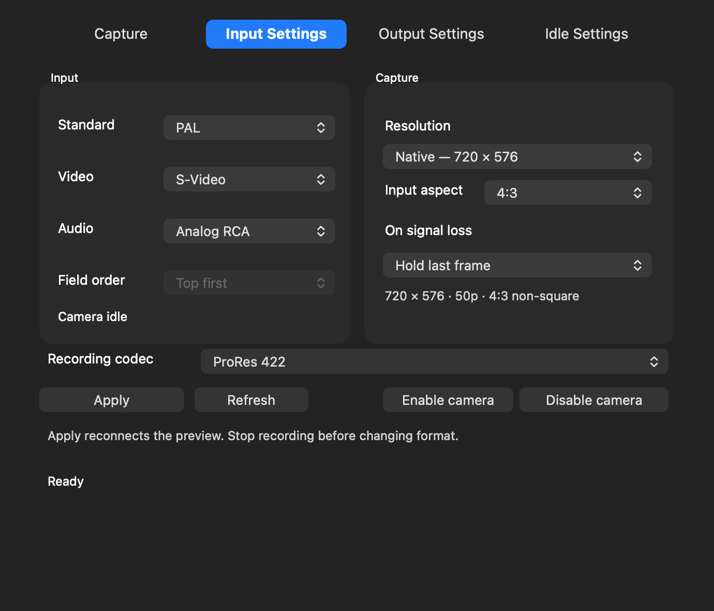

# Shuttle Camera 0.1.47 — recording codecs

Choose **Input Settings → Recording codec**. The choice is saved immediately and used for the next recording made with the app's **Record** button. It does not change the live camera feed or the recording codec selected by QuickTime or another application. No Apply or app restart is needed for codec changes.

| Recording codec | Progressive capture | Interlaced capture |
| --- | --- | --- |
| ProRes 422 (default) | Yes | Yes |
| ProRes 422 LT | Yes | Yes |
| ProRes 422 HQ | Yes | Yes |
| ProRes 422 Proxy | Yes | Yes |
| Uncompressed 4:2:2 (8-bit) | Yes | Yes |
| H.264 | Yes | No |
| HEVC | Yes | No |

All choices save a **.mov** file with **48 kHz stereo PCM audio**. The listening-volume slider does not change this audio. The selected codec appears in the Capture tab before recording.

ProRes Proxy/LT trade file size against compression quality; HQ uses more storage. Uncompressed applies no additional video compression to the camera samples and needs very large amounts of storage and a fast drive, especially at HD sizes and 50/59.94p. It does not restore detail absent from the tape. The default remains ProRes 422.

H.264 and HEVC use smaller-file progressive presets. They are disabled when an interlaced capture size is selected; the app does not silently deinterlace or change resolution. Choose a progressive input size to use them, or use ProRes/uncompressed to keep both motion fields. ProRes uses the established software encoder so interlaced fields can be preserved. H.264/HEVC prefer a hardware encoder when available.

The codec menu is locked while recording. Stop and save the recording before changing it.

## Open the recording when you stop

After you click **Stop** and the movie finishes saving successfully, it opens in the Mac's default application for .mov files. For example, it will open in VLC if VLC is your chosen default; the app does not force QuickTime.

To choose that player, select a .mov file in Finder, use **Get Info → Open with**, choose the application, then use **Change All** to apply that association to .mov files. Failed or empty recordings are not opened automatically. Quitting Shuttle Camera saves an active recording cleanly without launching a player during quit.

## Installation and validation

Stop capture/output and quit camera apps, editors and Shuttle Camera before installing Shuttle-Capture-0.1.47.pkg. Camera19, output12, audio3 and Premiere1 are unchanged; already enabled drivers do not need reactivation.

Actual encode/decode tests cover 96 combinations of codec, PAL/NTSC, native/HD, field order and supported progressive/interlaced capture. Saved codec identifiers, aspect metadata, frame timing, separate interlaced field rows and stereo PCM were checked. Runtime rejection protects interlaced capture from progressive-only codecs. UI checks cover saved preferences, enabled/disabled menu items, layout and opening through the system default-player API using a fake workspace. Physical long-duration recording throughput and opening on your installed default player still need a live check.

[Previous update: meters, audio monitoring and settings](Whats-New-0.1.46.md)
