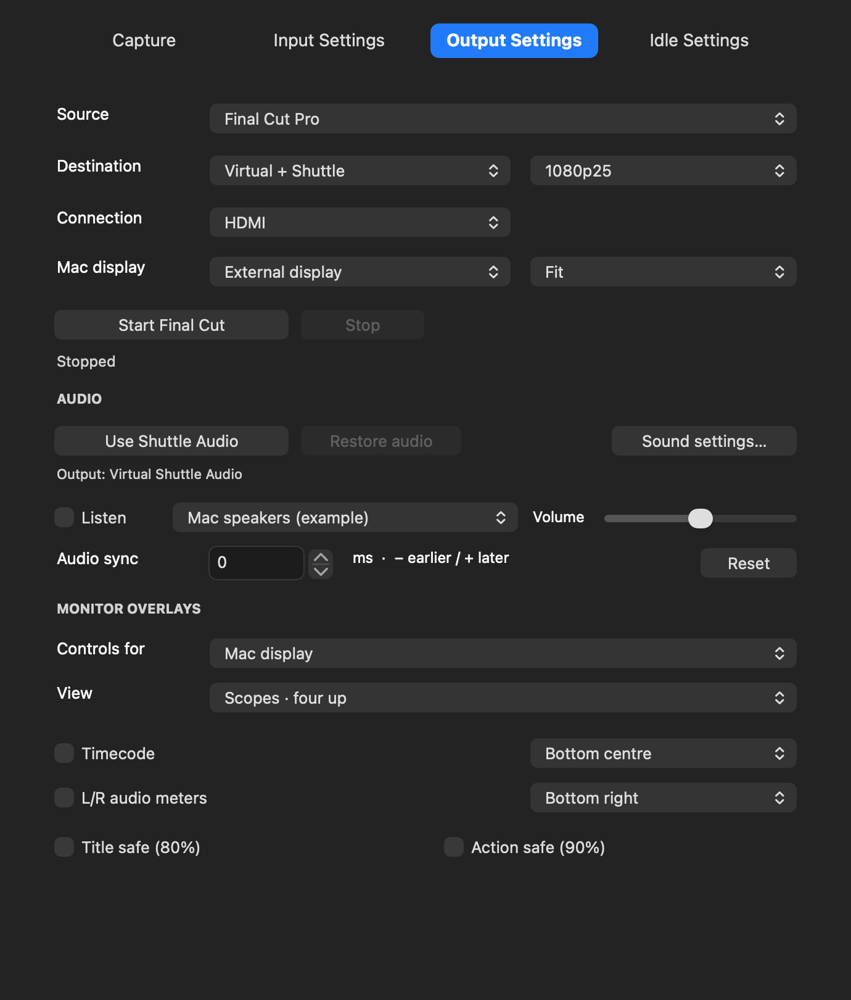
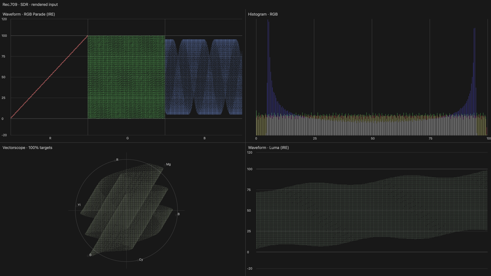

# Shuttle Video 0.1.49 — scopes and simultaneous outputs

## Picture on one screen, scopes on the other

In **Output Settings** choose **Final Cut Pro → Virtual + Shuttle**. Choose the Mac display, physical connection and video format, then **Start Final Cut**. Wait for **Ready for Final Cut**.

In Final Cut select **Virtual Shuttle** under **Settings → Playback → A/V Output**, then enable **Window → A/V Output**. Keep Shuttle Video open. Final Cut sends one rendered timeline feed, including effects, colour corrections and titles; Shuttle Video sends it to both destinations. The physical USB clock and per-frame acknowledgements remain the master in simultaneous mode.

Use **Controls for** to select which output you are adjusting:

- **Shuttle output → View: Video**; enable timecode, L/R meters and safe guides as wanted.
- **Mac display → View: Scopes · four up**; turn off that display's timecode/meters/guides for an unobstructed scopes picture.

You can reverse those choices, put scopes on the Shuttle TV and video on the Mac display, or choose another scope on each. View and overlay changes apply while output runs. Fit / Fill / Stretch affects the Mac display; the physical stream retains its selected output raster. Both destinations use the same selected standard/frame cadence. Simultaneous independent HD and SD conversion is not included.

*Actual app controls rendered with example devices. The live hardware/editor result still needs testing after installation.*

The existing single-destination **Intensity Shuttle** and **Virtual Shuttle** choices remain. For hardware-only select **Intensity Shuttle — HDMI Output** in Final Cut; for Virtual-only or simultaneous select **Virtual Shuttle**. Final Cut selects one A/V device; the app performs the duplication.

## Scope choices

**Video**, **Scopes · four up**, **Waveform · Luma**, **Waveform · RGB parade**, **Waveform · RGB overlay**, **Vectorscope** and **Histogram · RGB**. Four-up shows RGB parade, RGB histogram, vectorscope and luma waveform.

Scopes measure the incoming rendered video **before Shuttle's monitoring overlays**. Timecode, meters and safe guides added by this app do not contaminate the measurements. Titles and effects rendered by Final Cut are part of the source picture and are measured. If enabled, the monitoring overlays are drawn over the finished scope view.

This is an SDR software monitor of the sampled 8-bit UYVY output feed, with Rec.709 matrix for HD and Rec.601 for SD, indicated on the picture. Luma/RGB waveforms cover approximately −20 to120 IRE. The histogram covers0–100% with out-of-range values collected at its endpoints. The vectorscope shows100% colour targets. It is not a calibrated instrument, HDR scope or a copy of Final Cut's scope window. Scope pictures refresh at up to12.5fps to limit processing; ordinary Video continues at the selected video cadence. Idle pictures are shown normally after the configured timeout.

## Sound and timing

Click **Use Shuttle Audio** so Final Cut's sound enters **Virtual Shuttle Audio**. The same timeline audio drives the physical output and both sets of meters in simultaneous mode. **Listen** sends one local speaker/headphone copy; it is not duplicated by the screen helper. Monitor volume never changes meter readings or outgoing device audio.

Simultaneous mode uses the physical **Audio sync** offset. Virtual-only retains its separate saved offset. The Mac display is scheduled from the USB presentation clock, but screen buffering and TV processing can add different latency; check sync on your actual monitors. Capturing/recording from the Shuttle and physical playback remain mutually exclusive.

## Startup and installation

Stop all capture/output and quit camera/editor/Shuttle apps, then install **Shuttle-Video-0.1.49.pkg** using the macOS administrator prompt. The app/helpers update; camera21, output13, audio4 and Premiere2 are retained byte-for-byte. If output13 is already active, no replacement/reactivation is needed.

If **Start Final Cut** reports an output-driver error after installing0.1.48, use **Help → Driver Setup → Enable Final Cut Outputs**. We found macOS could show output13 enabled while its replacement launch service had failed with “Operation already in progress.” After the old service exits, requesting activation again starts it. Leave Final Cut's A/V Output off until Ready appears. Do not reset all system extensions or change SIP again for this issue.

The existing unsigned/ad-hoc development security requirements still apply. Universal arm64/x86_64 targets macOS14.4+; Intel runtime remains untested. The separate Shuttle Player is unchanged.

## Checks

Analytical black/white/superwhite, colour, histogram, waveform and neutral-vector fixtures pass, along with all six scope renders at SD/HD. Cross-process fan-out checks verify picture/PCM/timecode consistency and nonblocking behaviour with a stalled reader. Actual packet-generator fixtures pass all six modes with unchanged Video packets and an untouched pre-overlay feed for the other destination. Independent preferences and hidden UI/geometry tests pass. Installer tests and exact expanded payload checks run before delivery.

Live simultaneous Final Cut/TV/display playback, editing effects/titles while paused and playing, audio/listening/meters and long-session stability still need checking. No GitHub publication is performed by this build.
