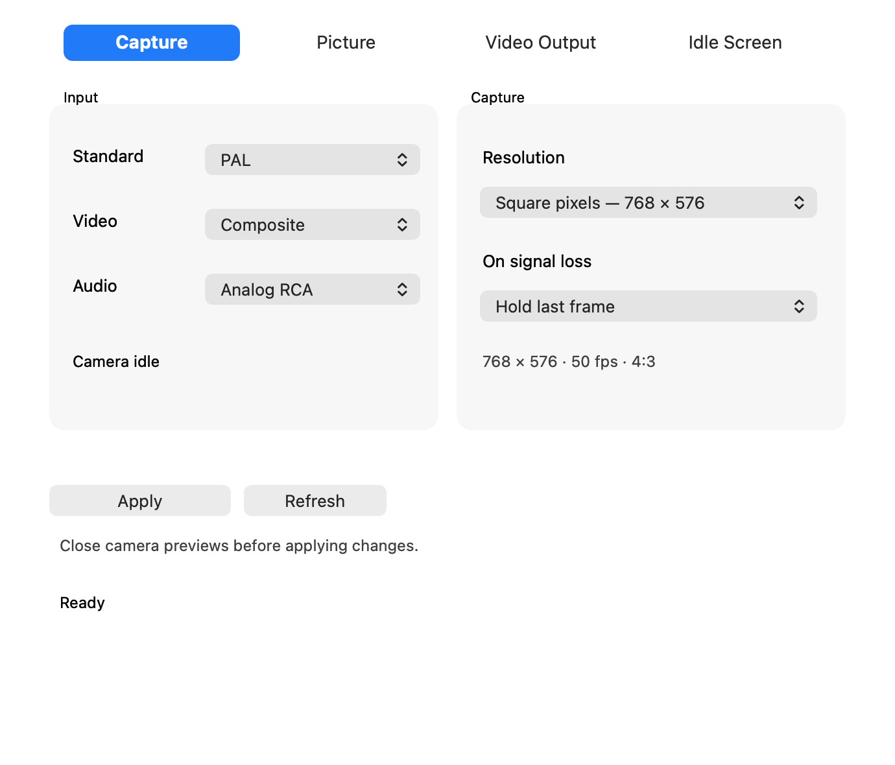
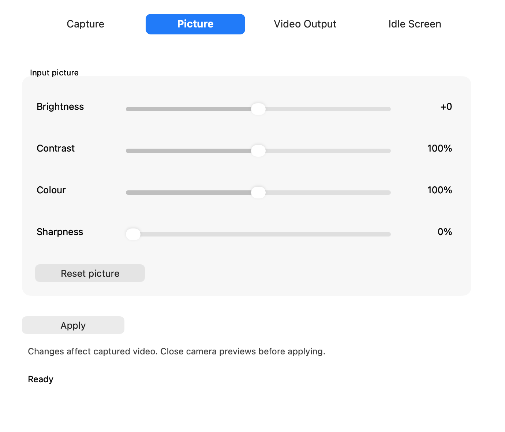
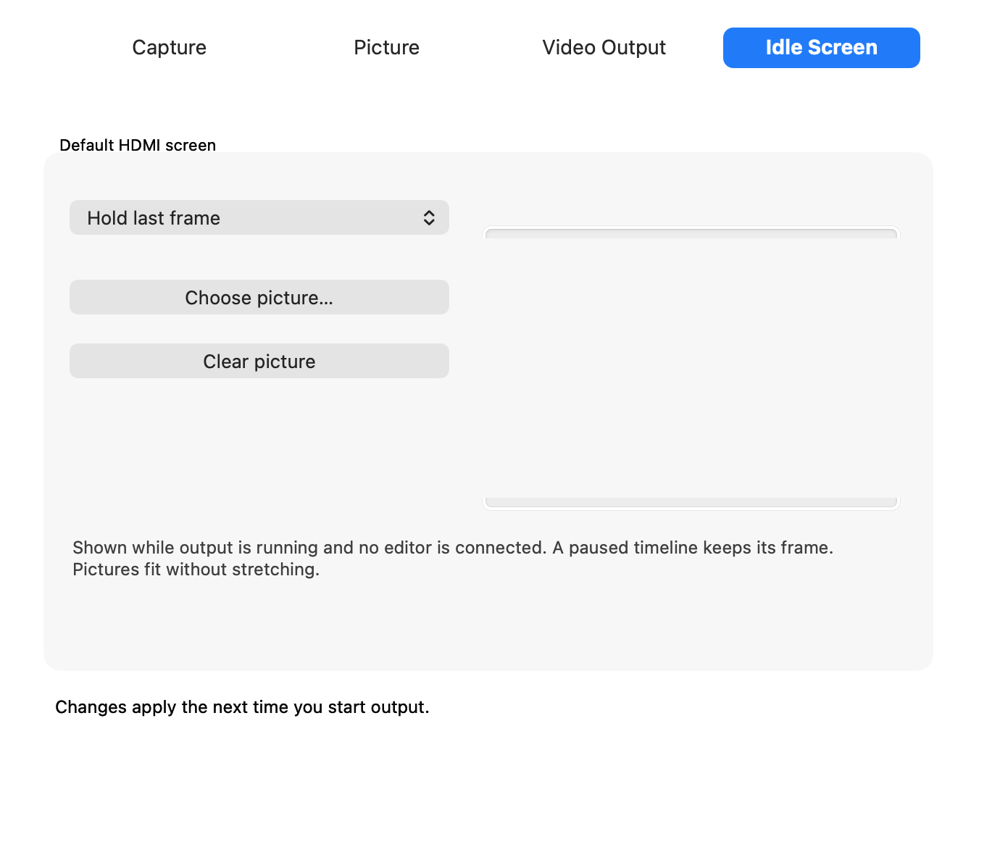
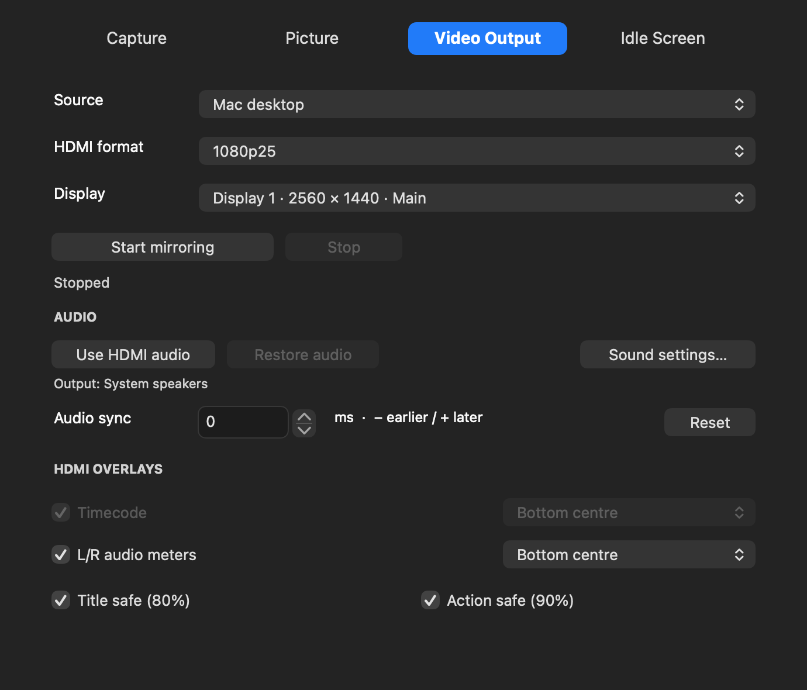

# Shuttle Camera 0.1.32 — new controls

Development candidate for Apple silicon/macOS27. No security requirements have changed. The earlier illustrated PDF in user-guide describes the baseline installation; use these instructions for the new interface. New HDMI/capture behaviour still needs live testing on the Shuttle before release qualification.

## Installation

Disable A/V Output/Mercury Transmit in your editor, quit Final Cut/Premiere, stop recording and output, then quit Shuttle Camera. Install Shuttle-Capture-0.1.32.pkg. Open Shuttle Camera and choose Help → Driver Setup → Enable Camera. Approve Shuttle Camera Extension in System Settings if requested. Picture controls require capture extension16; the other drivers retain their prior versions.

## Capture

Choose PAL or NTSC, video/audio inputs, resolution and signal-loss behaviour in the grouped Capture panel. Existing settings are retained. Apply requires all camera clients to be closed. Reopen QuickTime or your capture app after applying.

## Picture

Brightness (−100 to +100), contrast (0–200%), colour/saturation (0–200%) and horizontal sharpness (0–100%) are software controls on captured video, applied after field deinterlacing and before resizing. They affect recordings and every client of the camera. They do not alter movie/editor playback or the physical HDMI input passthrough. Increasing sharpness cannot recover lost VHS detail.

Neutral values are brightness0, contrast100%, colour100%, sharpness0%. With all controls neutral, the pixel processing is bypassed and the original levels are preserved. When adjusting, processed luma/chroma are kept within video levels. Reset picture restores the neutral slider values; click Apply to save them. Close camera previews before applying and reopen afterward. These are saved controls, not a live preview adjustment panel.

## Idle Screen

Choose Hold last frame, Black, Colour bars or Picture. Choose picture imports a resized copy into your user Application Support/Shuttle Camera folder; moving the original file afterward is fine. The picture fits the selected HDMI format without stretching, with black borders where necessary.

Start Final Cut or Premiere output in Video Output to keep the USB sender running. The idle choice applies before any editor frame is received and when the editor disconnects. A paused connected editor keeps its own frame. Stop output releases the hardware; it cannot continue showing an idle screen after the sender stops. Changes to idle-screen preferences take effect the next time output starts. Missing/unreadable pictures fall back to black.

## Mac desktop to HDMI

In Video Output, choose Mac desktop, a connected display and an HDMI format, then Start mirroring. macOS requires permission under System Settings → Privacy & Security → Screen & System Audio Recording. Allow Shuttle Camera, then quit/reopen it if requested. Re-select a display if it is disconnected. The display, including its cursor, is scaled to fit the HDMI picture. This mirrors an existing screen; it does not create an extended Mac desktop. Protected content may not be capturable.

Use HDMI audio routes Mac media sound to the TV through the existing Core Audio driver. Stop restores the saved normal sound output unless you selected another device yourself. Desktop video and audio sync still require a live TV check. Do not run editor output/capture simultaneously with mirroring.

Timecode remains an editor-only overlay. Audio meters and safe guides remain available. Existing movie looping, Final Cut and Premiere routes are retained.

## Verification limits

Pixel fixtures, settings validation, UI hit tests and installer tests passed. ScreenCaptureKit delivered a full 1920×1080 UYVY frame from the selected display in a separate read-only probe; no screen image was saved and no USB output was started. That probe does not prove the installed app’s permission state, HDMI colour/timing or sound alignment. Live capture, idle/resume, desktop-to-TV and editor regression checks remain before publishing this version as tested.
