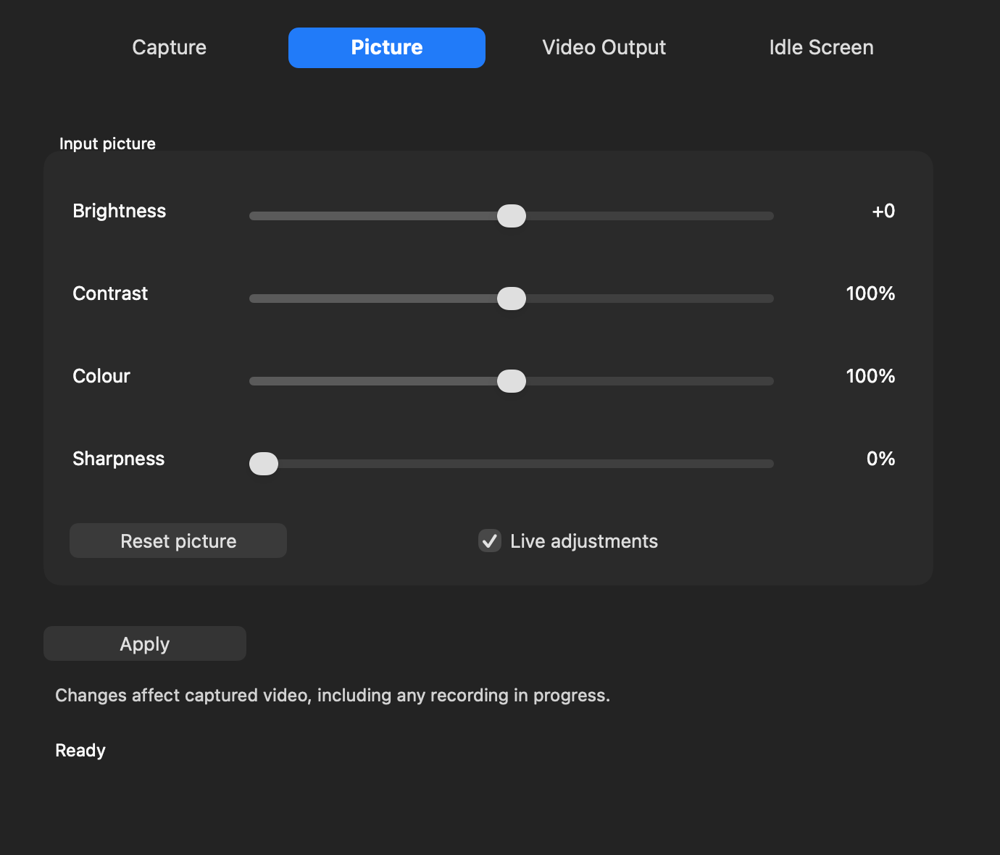
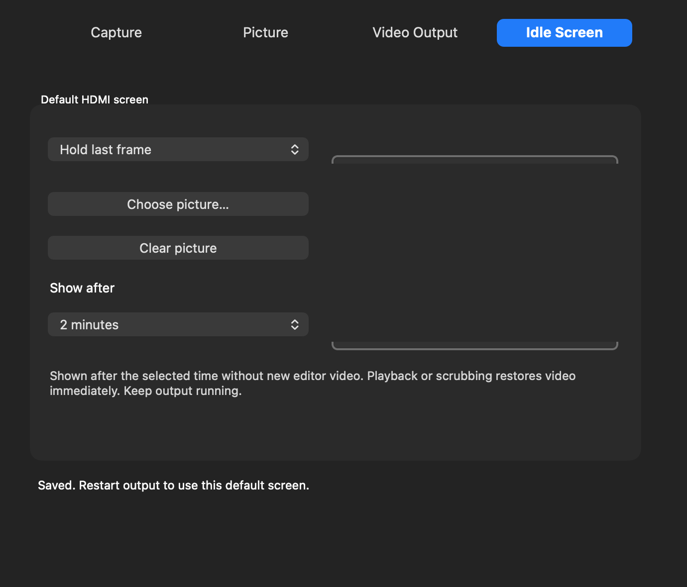

# Shuttle Camera 0.1.33 — live picture and timed idle

## Update the active camera driver once

Installing the app does not automatically replace an active camera extension. If picture controls do nothing, the earlier camera driver may still be active. The app now checks this and offers **Enable picture controls…** on the Picture panel. Version17 is required for live changes; version16 supports only saved changes with the preview closed; version15 has no picture controls.

Stop recording, close all camera previews, quit editors, stop output and quit Shuttle Camera before installing0.1.33. Then open the app, click Enable picture controls… or Help → Driver Setup → Enable Camera, and approve Shuttle Camera Extension in System Settings if requested. Reopen the app or click Capture → Refresh after activation. This one-time update requires closing previews; normal picture adjustments afterward do not.

## Live picture controls

Open your capture preview and leave the video playing. In Picture, enable **Live adjustments**, then move Brightness, Contrast, Colour or Sharpness. The captured video updates after a short debounce, without restarting the camera, resetting timestamps or interrupting audio. These adjustments also affect a recording in progress.

Turn Live adjustments off to edit sliders without applying them; click Apply when ready. Reset picture restores brightness0, contrast100%, colour100%, sharpness0%; with Live adjustments enabled it also updates the preview. Neutral settings bypass picture processing, preserving the original levels. Input, standard, resolution and signal-loss changes still require closing capture clients.

## HDMI idle delay

In Idle Screen, choose the idle picture and **Show after**: Immediately, 30 seconds, 1 minute, **2 minutes (default)**, 5 minutes, 10 minutes or Never. Restart output after changing these preferences.

The timer measures time without newly received editor frames, including a paused or disconnected editor. It does not compare images: a still picture playing on a timeline remains active because frames continue to arrive. After the delay, the chosen hold/black/bars/picture policy applies. Playback or scrubbing immediately restores editor video and restarts the timer. Timecode is hidden while the idle policy is active. Keep the USB sender running; stopping output releases the hardware.

The idle timer applies to Final Cut/Premiere editor output. Desktop mirroring and normal movie playback retain their existing behaviour. Hold last frame deliberately keeps the last picture, so select bars, black or a picture for a visibly different idle screen.

## Validation

The actual camera frame pipeline was tested with synthetic PAL fields before/after a live picture update: luma changed from90 to145 and both chroma channels became128 for brightness+25/colour0, while preserving the same device and stream. Device tests also cover preference persistence, property notification, old clients omitting picture fields, invalid values and rejection of hardware-format changes during capture. No USB stream or installed camera was opened by these tests.

Deterministic timer tests cover exact two-minute expiry, reset on playback/scrub, continuous static video, all delay choices, immediate/never and invalid values. Native UI mocks cover driver15/16/17 capabilities and saved delay choices without real device writes, audio changes or helper launches. Installer tests and payload expansion are part of the package build.

Installed hardware confirmation of live adjustments and timed HDMI idle is still needed. The existing experimental signing/security requirements are unchanged. No GitHub changes were made. See Whats-New-0.1.32.md for desktop mirroring and earlier user-guide/Read Me.pdf for the baseline security procedure.
