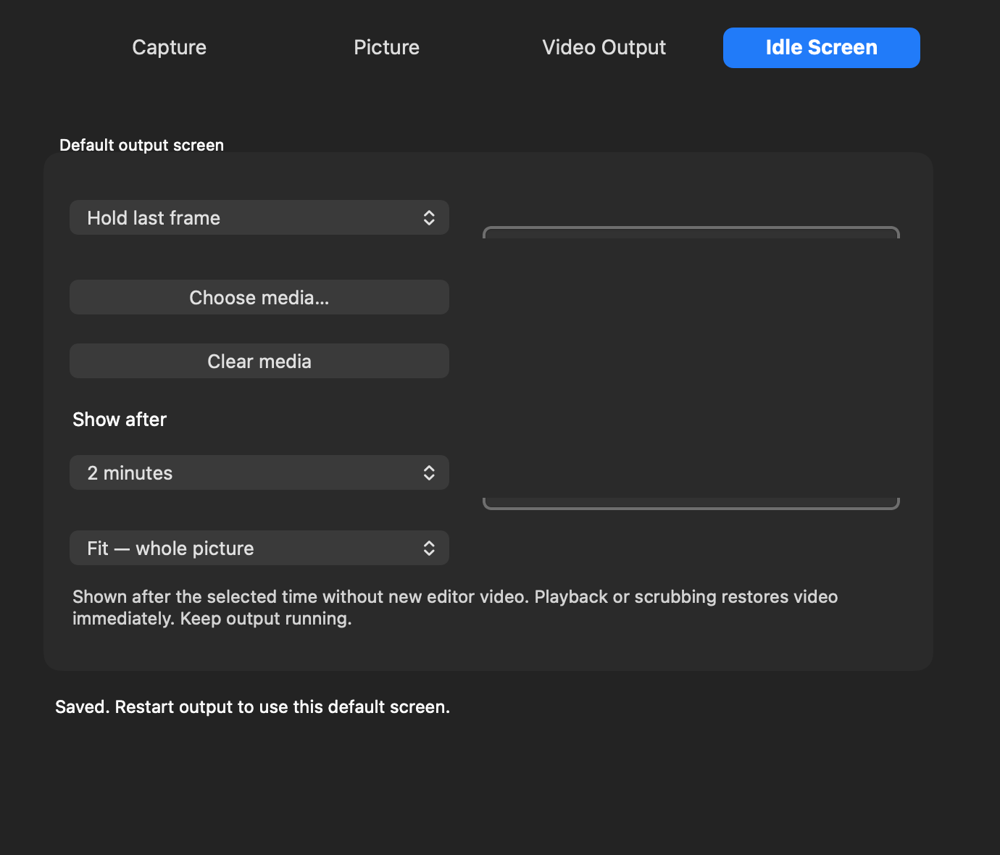
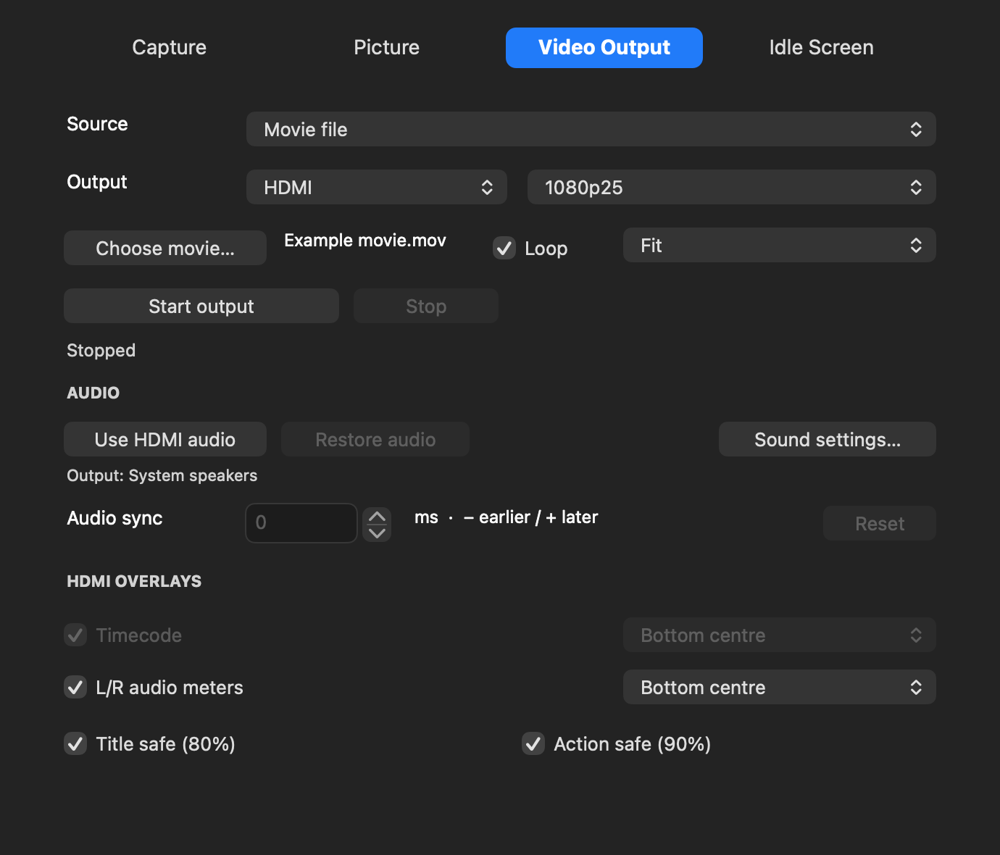
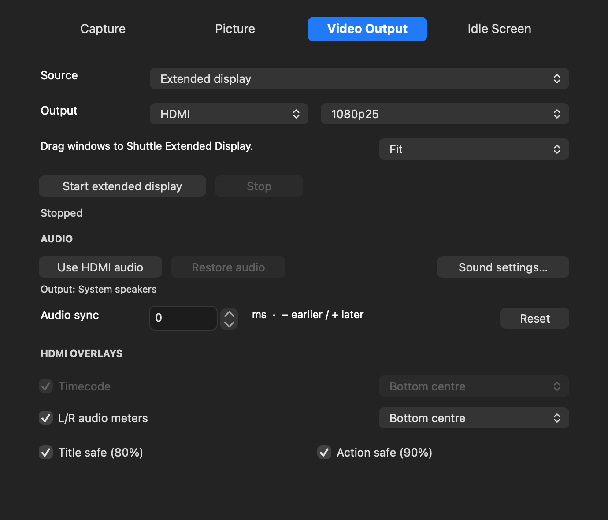

# Shuttle Camera 0.1.36 — sizing, connectors and extended desktop

## Fill the output frame

In **Idle Screen**, choose Picture or Movie loop (silent), click **Choose media**, then choose:

- **Fit** keeps the whole picture and its proportions, with black borders where needed.
- **Fill** fills the frame without distortion, cropping edges where needed.
- **Stretch** fills the frame by changing its proportions.

Movies loop silently while the idle screen is displayed. Keep the selected movie at its original path. An imported still picture is saved in Application Support. Missing/unreadable media produces black with a diagnostic. Restart output after changing idle media or sizing. The default wait is still two minutes without new editor frames; choose another delay or Never. Playback or scrubbing restores editor video immediately. This is an editor-output idle screen, not a camera signal-loss replacement.

The same three sizing options are available for **Movie file**, **Mac desktop** and **Extended display** in Video Output. Each frame is rendered into the selected wire resolution, with PAL/NTSC pixel proportions taken into account. Final Cut and Premiere continue rendering their negotiated output format; this update does not add arbitrary editor-stream resizing or change their qualified clock/completion handling.

## Output connector

Choose **HDMI**, **S-Video**, **Composite** or **Component**, then the format. S-Video and composite offer PAL or NTSC only. HDMI/component retain SD and the supported 1080 modes. Selecting an analogue SD connector converts an incompatible saved HD choice to the matching PAL/NTSC mode. Media is scaled into that mode, rather than sending HD timing to an SD input. The connector choice is saved.

The Shuttle can drive compatible connectors simultaneously: this choice constrains formats, not an exclusive hardware switch. It does not implement simultaneous HD HDMI plus downconverted SD analogue output. See the [Blackmagic Intensity manual, page17](https://www.bhphotovideo.com/lit_files/20004.pdf).

On this Mac, the user confirmed composite and S-Video output during capture. Mac-generated playback through these connectors and component output still require live qualification. HDMI playback was qualified in earlier versions. Do not infer analogue playback qualification from capture passthrough alone.

## Separate extended desktop — experimental

1. Close Shuttle camera previews and stop capture. Choose **Extended display** in Video Output.
2. Choose the connector, output format and sizing. Click **Start extended display**.
3. Allow Shuttle Camera under **System Settings → Privacy & Security → Screen & System Audio Recording**, if requested. Reopen the app after granting permission.
4. Move a window to **Shuttle Extended Display**. It starts to the right of existing screens. Arrange it in **System Settings → Displays** if desired.
5. Click **Use HDMI audio** if Mac media sound should follow it. Click **Stop** when finished; the virtual display is removed and the saved sound route is restored.

This creates a separate desktop rather than mirroring an existing screen. The virtual screen is1920×1080 for HD,768×576 for PAL, or648×486 for the720×486 NTSC output raster, preserving square desktop pixels at the correct physical proportions. It uses60Hz desktop timing and samples into the selected25/29.97 output cadence; it is not a direct GPU monitor connection. Protected media may not be capturable. No desktop audio is captured by ScreenCaptureKit; sound uses the existing Core Audio route.

The virtual display uses an undocumented CoreGraphics interface. It may change after a macOS update and is not an Apple-supported public display-driver API. A separate helper owns it, exits when stopped or its parent disappears, and closes its WindowServer connection to remove the display. No kext or firmware change is involved. Choose **Mac desktop** to mirror an existing screen instead if virtual-display creation fails.

## Verification and installation

Native Apple-silicon build and signature verification passed. Isolated UI checks passed with no USB, device-setting writes, audio-route changes or helper launches. Synthetic media tests decoded all three sizing choices at all six wire modes, checked exact rasters, black borders and silent movie looping; imported-picture tests checked Fit/Fill/Stretch. A reversible live test on this Mac created a separate1920×1080 display, captured a red test window using ScreenCaptureKit, stopped it and verified its removal from the online-display list. These are software/display checks, not a new TV timing or analogue qualification.

Before installation, disable editor external output, quit the editors and camera clients, stop capture/output, and quit Shuttle Camera. Install0.1.36 using your administrator password in macOS. Host36 includes the display helper; camera17, output12, HAL3 and Premiere1 are unchanged. No driver reactivation is needed if already enabled. Existing development signing/security requirements remain unchanged. The baseline PDF guide predates these controls; use this document for the new options.
