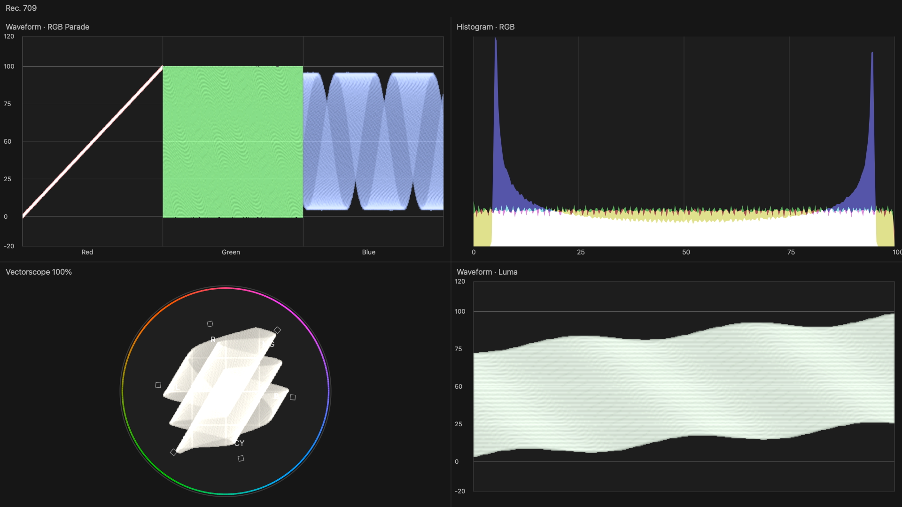
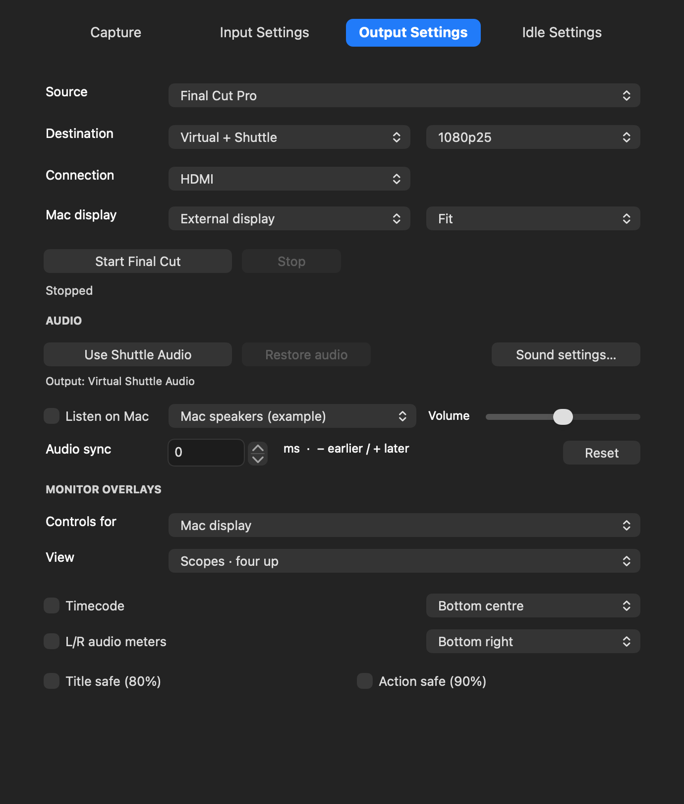

# Shuttle Video 0.1.50 — scopes and listening

## Scope appearance

Waveform traces now use a continuous, lightly filtered density raster instead of isolated dots. This removes the regular enlarged dot grid and makes the trace easier to see. The plot background is dark grey, with quiet reference lines. The vectorscope has a circular coloured rim, six labelled rotated target boxes and a bright neutral trace. SD output compensates for non-square output pixels when drawing the circle.

The scopes are original software displays, inspired by familiar editing monitors. They analyse the rendered 8-bit SDR feed before Shuttle timecode, meters and safe guides, using Rec.709 for HD and Rec.601 for SD. They remain sampled monitoring aids, not calibrated measurement instruments or HDR scopes. Filtering softens density over adjacent analysis bins; tiny details are approximate.

## Playback performance

Scope analysis, CoreGraphics drawing and colour conversion run on a separate worker for each destination. The USB callback and display tick submit the latest frame without waiting for the worker. A single pending request replaces older pending frames; no growing render queue is possible. The last completed scope image stays visible until a newer one is ready. The first scope image can briefly be black while its initial render completes.

The old fixed 12.5 fps cap is removed. A 25/29.97 fps output can update scopes at that cadence when the renderer keeps up; a busy machine can skip scope updates while keeping video transport independent. The Mac display helper also avoids an unnecessary full-frame copy. Video mode and the existing USB timing, clock, credits and audio alignment remain unchanged.

## Audio and meters

1. Click **Use Shuttle Audio**. Final Cut must send audio to **Virtual Shuttle Audio**, rather than directly to Mac speakers.
2. Enable **L/R audio meters** for each destination that should show them.
3. To hear the same audio on the Mac as well as the Shuttle, enable **Listen on Mac** and choose speakers/headphones.
4. Listen volume affects only those local speakers. Muting listening does not stop the meters or lower Shuttle audio.
5. Stop output to restore the saved normal Mac audio route. If you change the system output yourself, Shuttle respects that choice.

Choosing speakers in the Listen menu selects a listening destination; it does not tap or record that device's other audio. Audio sent straight from an editor to Mac speakers bypasses the Shuttle receiver and cannot drive these meters. No extra audio recording permission or output-device tap is introduced.

## Install and test

Stop recording/output, disable editor external output, and quit camera/editor/Shuttle apps before installing. Camera21, output13, audio4 and Premiere2 are unchanged. If output13 is already enabled, no driver replacement is needed. An installed output driver can be checked in System Settings → General → Login Items & Extensions → Camera Extensions.

After installation start Final Cut output in Shuttle Video and wait for Ready. In Final Cut select Virtual Shuttle for a Mac-only or paired destination; select Intensity Shuttle for hardware-only. Compare video on one output and scopes on the other, scrub and play/pause several times, then try the reverse layout. Keep the editor's frame rate and output mode compatible.

Offline validation covers the analytical scope values, continuous HD waveform raster, asynchronous stale-view/cache behaviour, unchanged Video USB packets and clean pre-overlay fan-out, display conversion and independent listening/meter levels. A live test of 0.1.50 on the TV and chosen Mac display is still pending. Intel runtime is untested. Existing development security requirements are unchanged.
