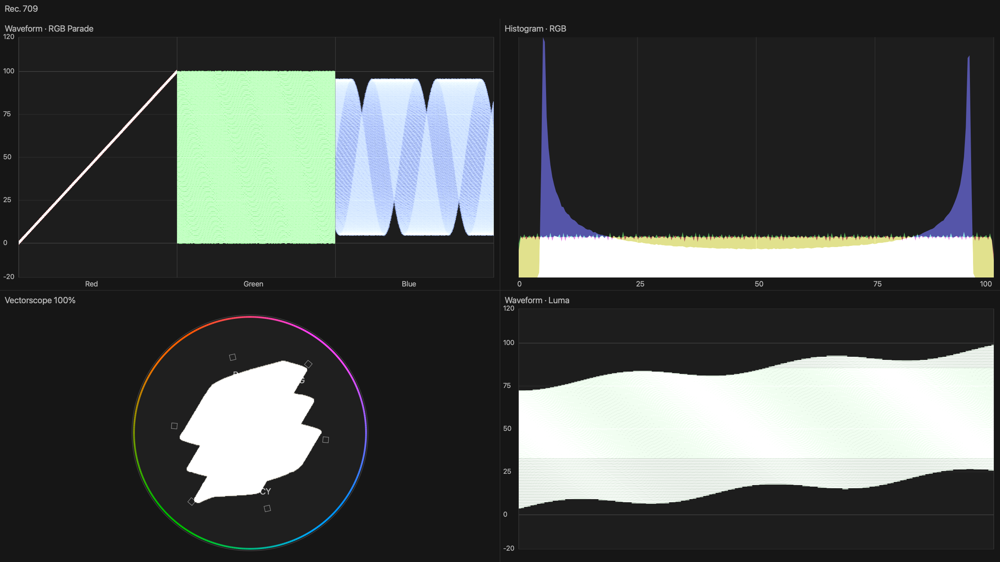

# Shuttle Video 0.1.51 — sharper, clear scope displays

## More waveform detail

Waveforms now use an analysis grid of up to **960 columns × 768 level rows**, compared with 320×256 in the earlier build. Both luma pixels in every sampled UYVY pair are measured, rather than skipping across the image. The denser vertical sampling also improves histogram stability. Histogram amplitude remains 256 bins because the received picture is 8-bit SDR; this update does not invent extra source precision.

## Native Mac-display graphics

Mac-display scopes are drawn directly in RGB at the selected window's backing-pixel resolution, capped at **3840×2160** while preserving its aspect. A 2560×1440 display receives a 2560×1440 scope image. Scope text and graphics no longer go through the hardware's 1920×1080 4:2:2 video conversion before being enlarged for the Mac screen. Physical scope output still uses the selected PAL/NTSC/1080 wire format.

Processing remains on a coalescing background worker, with one pending frame and the last completed display held until the next is ready. It never blocks USB playback for scope analysis. The higher-detail view can skip scope updates on a busy machine without accumulating latency; ordinary Video transport timing is unchanged. Scopes are sampled SDR monitoring aids, not calibrated instruments or HDR scopes.

## Clear scopes, remembered video overlays

Whenever a destination uses any scope view, **timecode, L/R meters, title-safe and action-safe guides are omitted automatically**. Their controls are disabled for that scope destination. Saved choices are retained and return when that destination switches back to **Video**.

This works independently for the Mac display and physical Shuttle. For example, use Video with timecode/meters on HDMI and clear four-up scopes on the Mac. Audio routing, local listening and internal meter measurement continue; hiding a meter does not mute anything.

## Install and check

Turn off editor A/V Output, stop recording/output and quit editor/camera/Shuttle apps before installing. Camera21/output13/audio4/Premiere2 are unchanged. An already enabled output13 needs no reactivation.

Start Final Cut output in Shuttle Video and wait for Ready. For **Virtual + Shuttle**, select **Virtual Shuttle** in Final Cut Settings → Playback and enable Window → A/V Output. Choose scopes for one destination and Video for the other. Confirm cleaner traces, no scope overlays and smooth playback; switch the scope destination back to Video to restore its saved overlays.

Use Shuttle Audio feeds editor sound and meters through Virtual Shuttle Audio. Listen on Mac adds the selected speakers/headphones at an independent listening volume. Stop restores the saved normal audio route unless you change it yourself.

Offline validation covers analytical/raster scope values, a one-pixel detail fixture, native 2560/4K RGB frame ownership, asynchronous coalescing/cache changes, actual overlay-free scope USB packets, unchanged Video wire packets and clean fan-out, UI enable/restore behaviour, installer guards and universal signatures. A live 0.1.51 comparison remains pending. Intel runtime is untested. Existing development security requirements are unchanged.
