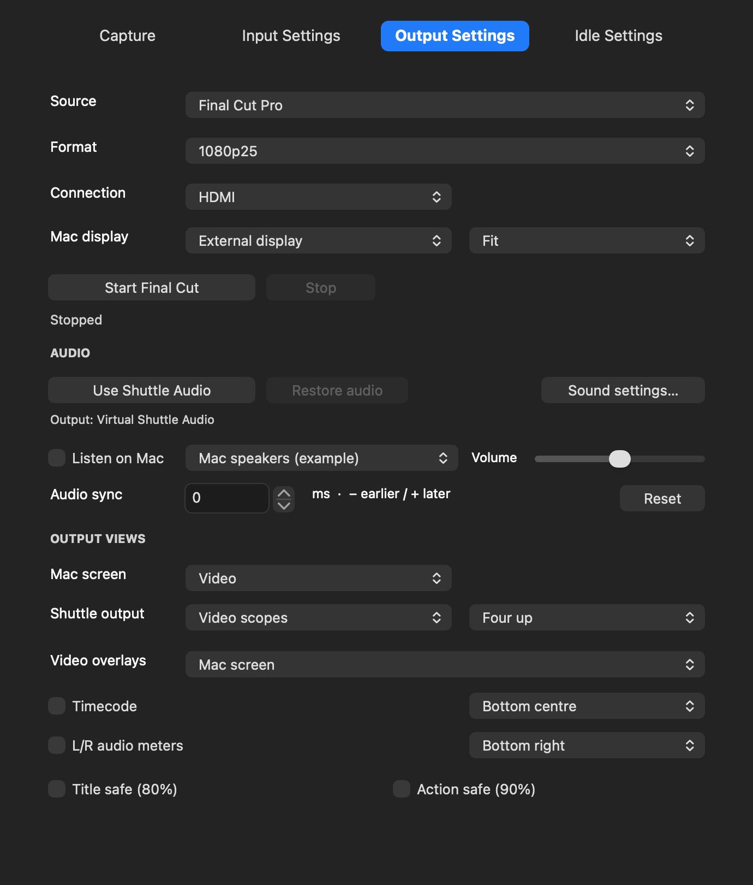
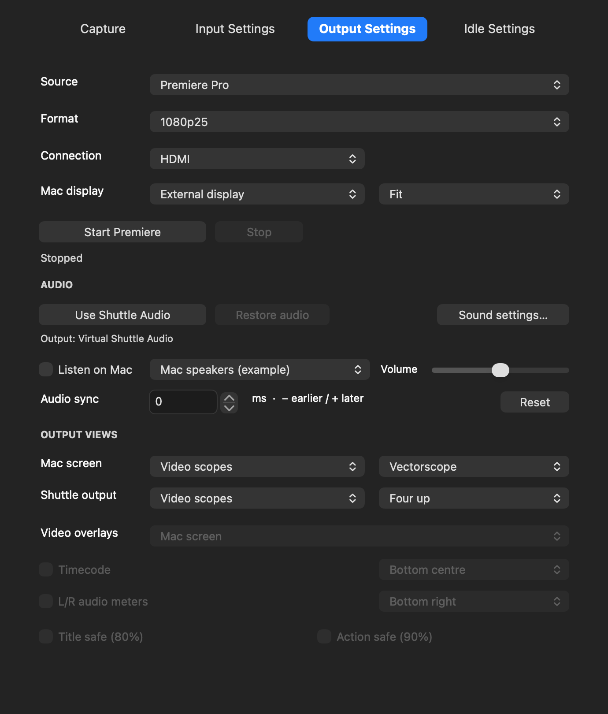

# Shuttle Video 0.1.53 — choose each screen's picture

Two visible menus replace Controls for / View:

| Output | Choices |
|---|---|
| Mac screen | Video / Video scopes / Off |
| Shuttle output | Video / Video scopes / Off |

These work with **Final Cut Pro and Adobe Premiere Pro**. Video on both, scopes on both, and split video/scopes are supported. Each scopes menu has its own Four up, Luma waveform, RGB parade, RGB overlay, Vectorscope or RGB histogram choice.

*Actual controls rendered offline with example devices; this is not evidence of a live editor connection.*

## Scopes on the Shuttle HDMI TV

1. Choose your editor as Source and a Format matching the timeline.
2. Set **Shuttle output → Video scopes**, then choose Four up or an individual scope. Choose the connector you are using.
3. Set **Mac screen** to Video, Video scopes or Off. When on, select the Mac display above.
4. Start output in Shuttle Video and wait for Ready before enabling the editor's external output.

Scopes use the clean rendered editor picture before monitoring overlays. TC, audio meters and safe guides are automatically omitted from scopes. For Video, **Video overlays** selects which output's saved TC/meters/safe-guide settings you are editing. Scope levels/colour and analysis are unchanged from the working 0.1.51 implementation.

## Final Cut Pro

With **Mac screen on**, select **Virtual Shuttle** under Settings → Playback → A/V Output, including when both outputs are on. With **Mac screen Off** and only Shuttle on, select **Intensity Shuttle — HDMI Output**. Then enable Window → A/V Output. Both receive rendered effects, colour and titles whenever Final Cut delivers a frame.

## Adobe Premiere Pro

The same two menus work for Premiere. Start and wait for Ready, then enable Mercury Transmit and **Intensity Shuttle — HDMI Output** in Premiere Playback settings. The existing plug-in name is retained even for Mac-only output. No replacement Transmit plug-in is required. The app now receives Premiere on a Mac display alone, or duplicates the feed to Mac and Shuttle together.

For audio/meters choose **Virtual Shuttle Audio** in Premiere Audio Hardware if Premiere uses an explicit output. **Use Shuttle Audio** changes the system media route; it cannot override Premiere's explicit audio selection. Enable **Listen on Mac** and choose local speakers/headphones if wanted. Listen volume does not change outgoing audio or meter levels.

## Live changes and Off

Video ↔ Video scopes and scope style apply while output runs. To change a destination to/from Off, disable editor external output and Stop in Shuttle Video first, change the menu, then start again and select the appropriate editor output. Both Off disables Start. Off means no sender/window for that destination; it does not power off the Shuttle's sockets. Enabled physical connectors may still carry the same compatible device signal.

Both views share the chosen output format/frame rate. Fullscreen Mac output, Escape/context-menu Stop, separate video overlay settings and existing audio offsets remain available. Audio clocks, USB pacing and scope processing were not changed.

## Install and validation

Stop recording/output and quit camera/editor/Shuttle apps before installing **Shuttle-Video-0.1.53.pkg**. Camera21/output13/audio4/Premiere2 are unchanged. Already enabled drivers need no reactivation.

Offline UI/launch tests cover all nine combinations for both editors, independent scopes/settings, migration from the old destination menu, disabled Off changes while running and readiness before editor enablement. Tests use fake tasks, preferences and device APIs. Native fullscreen/image tests, packet fan-out and universal signatures are checked separately. Live 0.1.53 HDMI/Premiere routing remains to be verified after installation. Intel runtime is untested. Unsigned/ad-hoc development security requirements are unchanged; the installer does not alter them. See the main user guide for security preparation/removal.
