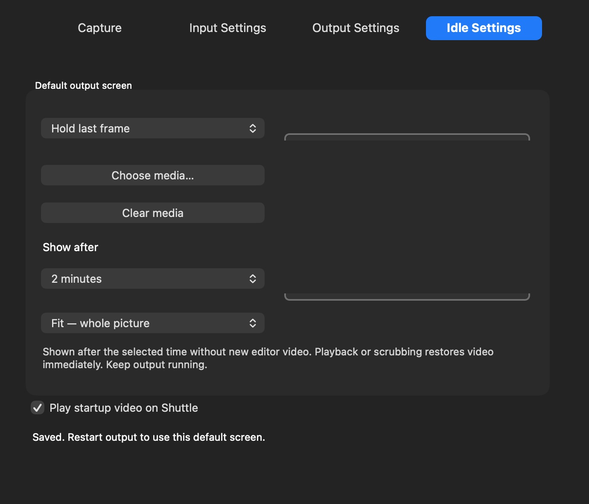

# Shuttle Video 0.1.54 — startup logo and current output guide

This release brings the repository forward from0.1.39 to Shuttle Video0.1.54. It includes the direct Capture/recording workflow, interlaced and progressive presets, recording codecs, Virtual Shuttle, independent scopes/video/off for Mac/Shuttle, local listening, higher-detail scopes and fullscreen output developed since that version. See README.md for the full workflow and0.1.53 for the two output menus.

## Startup movie

The supplied Startup.m4v is bundled inside the app. On a normal GUI launch:

1. If enabled, the app starts the movie on the physical Shuttle using the saved output format/connector. The whole image stretches into the selected raster, including PAL/NTSC.
2. The5.64-second movie plays once, including its audio, then keeps sending the **exact final frame with silence**. It does not loop or fall through to the editor idle picture.
3. Any app control/menu action first stops that launch-only sender. The app waits asynchronously for USB release before performing the action, preventing a race with Capture, Apply, recording, normal output or Quit. The interface stays responsive.
4. Turn it off using **Idle Settings → Play startup video on Shuttle**. The setting applies to the next launch. Ordinary editor idle settings stay separate.

*App screenshot uses offline example controls; it is not evidence of a live HDMI test.*

Startup is skipped if the device is unavailable or capture/output already owns it; it does not stop another application. It uses the existing camera preflight and therefore requires the camera extension to be configured. It does not change system sound routing, capture settings, editor mode or monitoring choices. Saved scopes, TC, audio meters and safe guides are suppressed for the startup logo. The helper also stops if the host exits unexpectedly.

## Independent editor outputs

Choose Final Cut Pro or Premiere Pro in Output Settings. **Mac screen** and **Shuttle output** each offer **Video / Video scopes / Off**. Both video, both scopes, or a split view are possible. Scope types are independent. Video/Scopes switches are live; Stop and disable editor external output before switching a destination on/off. See [illustrated steps](Whats-New-0.1.53.md).

With Mac screen on, Final Cut uses **Virtual Shuttle**; Shuttle-only uses **Intensity Shuttle — HDMI Output**. Premiere uses the existing **Intensity Shuttle — HDMI Output** Mercury Transmit plug-in for all three routes. Route editor audio through **Virtual Shuttle Audio** for meters and physical sound; Listen on Mac adds local speakers/headphones. Premiere’s explicit Audio Hardware choice is separate from the system output button.

## Included Shuttle Player

Shuttle Player0.1.1 is a separate universal app. Copy it to Applications from the complete ZIP. Open a movie, then Play; it cleanly asks Shuttle Video to quit before taking USB and waits for existing recording/output to finish. It has a scrub bar, centred transport icons, Loop and playback volume. Stretch is the default; no scopes/meters/safe-guide burn-ins. Its unchanged full source/build instructions are in player/. Intel runtime remains untested.

## Installation and security

Disable editor external output, stop recording/capture/output and quit camera/editor/Shuttle apps. Install **Shuttle-Video-0.1.54.pkg**, entering the administrator password directly in macOS. No driver reactivation is needed if already enabled: camera21/output13/audio4/Premiere2 are byte-identical to0.1.53. The installed app is **/Applications/Shuttle Video.app**. The main app’s About menu identifies0.1.54.

This remains an **experimental unsigned installer with ad-hoc components and no notarization**. The installer requires the existing SIP-disabled development setup and never changes security settings. Read [security preparation and restoration](user-guide/Read%20Me.md#security-preparation) before deciding to install. macOS14.4+ universal main app; Apple silicon tested locally, Intel/older macOS runtime untested. This is independent community software, unaffiliated with Blackmagic Design, Apple or Adobe.

## Validation limits

Offline actual movie decoding verifies all six output formats, exact last-frame holding beyond EOF, silent tail and suppression of saved overlays/scopes. Fake-task application tests verify asynchronous release before user actions, multiple actions without duplicate termination, deferred Quit, missing asset and launch failure. Existing UI/output routing and installer mocks pass; universal bundles/signatures and expanded installer payload/source are verified. These checks do not establish a fresh-machine installation or live HDMI/startup/Premiere qualification. Retain that distinction when reporting compatibility.
