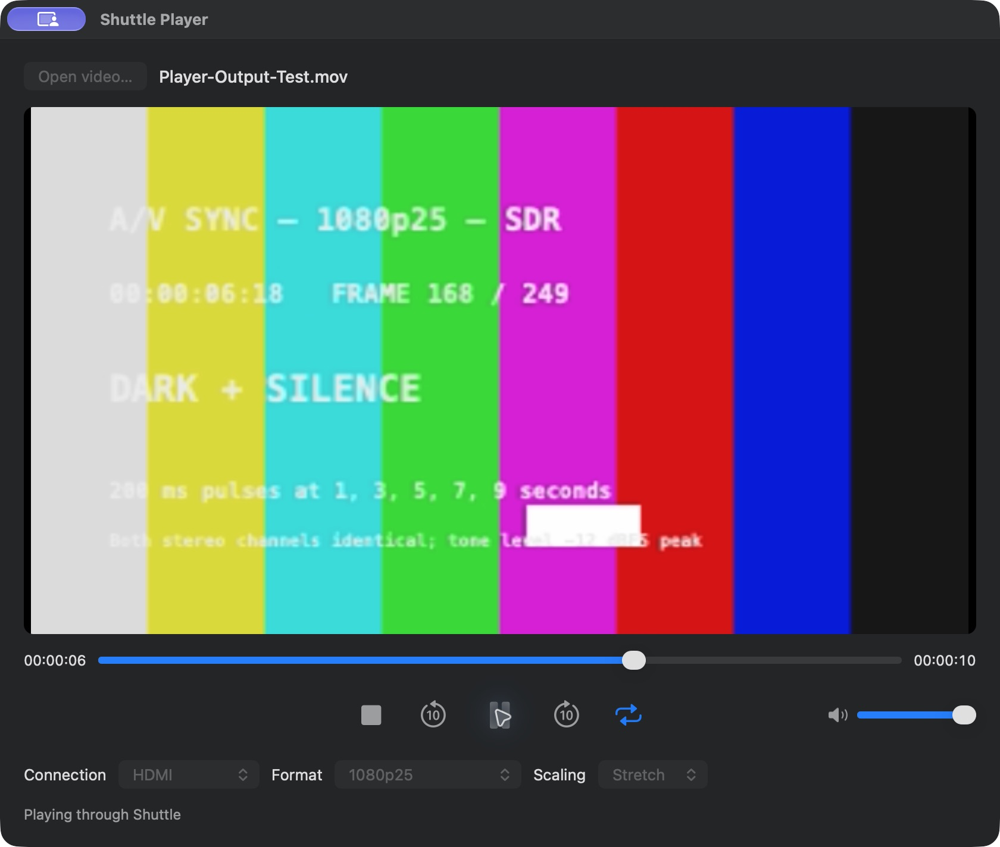

# Shuttle Video 0.1.54 + Shuttle Player 0.3.2

27 October 2026 · Experimental community release

Both apps now live together in the Intensity Shuttle USB 3.0 project and the Complete ZIP. **Shuttle Video, its installer, camera/audio extensions and editor plug-ins remain at the existing 0.1.54 release versions.** This update replaces the separate Player and adds its editable source and helper build inputs.

## New in Shuttle Player

- **File → Open Video URL… (⇧⌘O)** for public YouTube, Dailymotion and Vimeo videos. The URL dialog stays in the File menu; it never opens automatically at launch.
- **Download first** for a complete prepared local movie, reliable scrubbing and Loop. Progress shows downloading and preparation.
- **Stream** for earlier playback after about three seconds of paired picture/audio buffering. The rest arrives as needed; no complete movie is cached.
- **Stream scrubbing and ±10-second skips:** release the slider to jump, holding picture with silence while it buffers. Paused seeks stay paused; playing seeks resume. Latest position wins during rapid changes. Replay is available at the end; Loop uses Download first.
- Bounded YouTube media requests reduce the repeated buffering reported in the earlier Stream build. Slow connections and site changes can still interrupt playback.
- Existing local-file controls, stereo sound, volume, PAL/NTSC/1080 modes and Stretch/Fit/Fill remain. No main-app or driver update is needed for existing 0.1.54 users.

The screenshot shows the actual transport and output controls using synthetic local footage. See the [Player guide](../player/README.md) for URL methods, cache behaviour, installation, building and troubleshooting.

## Install

Download the **Complete ZIP** from the [combined release](https://github.com/MasterCatsUK/intensity-shuttle-usb-3.0-driver/releases/tag/v0.1.54-player-0.3.2). For a first installation, read the main [security preparation/restoration guide](user-guide/Read%20Me.md#security-preparation), close capture/editor/Shuttle apps and install `Shuttle-Video-0.1.54.pkg`. Copy `Shuttle Player.app` into Applications separately. Existing main 0.1.54 users can download just the Player ZIP and replace Player while it is closed. The package does not install Player, and this companion update does not change macOS security settings.

## Limits and checks

Public on-demand content only, when a compatible stream is available. Sign-in/password, DRM, live/upcoming videos and guaranteed support for every link are outside scope. No browser cookies or credentials are read. Use content you have permission to play. Source video up to 1080 is requested; the device output formats are unchanged.

Offline regression, real network decoding and forward/backward/paused seeks passed for the three sites. The reported YouTube link ran for 120 seconds without a rebuffer in the delivery probe; the final seek build also passed a 30-second post-seek probe. These are software measurements on the development connection, not a bandwidth guarantee or a new physical HDMI qualification. The new 0.3.2 seek workflow still needs a user TV check. See [Player validation](../player/VALIDATION.md).

Both apps are experimental, ad-hoc signed and not notarized; the main installer is unsigned. Main camera/output development extensions require SIP disabled, weakening macOS protections. Main app target is macOS 14.4+, Player target is macOS 13+. Apple silicon is the tested hardware; Intel and older macOS runtime remain untested. No affiliation with Blackmagic Design, Apple, Adobe or the video sites.
