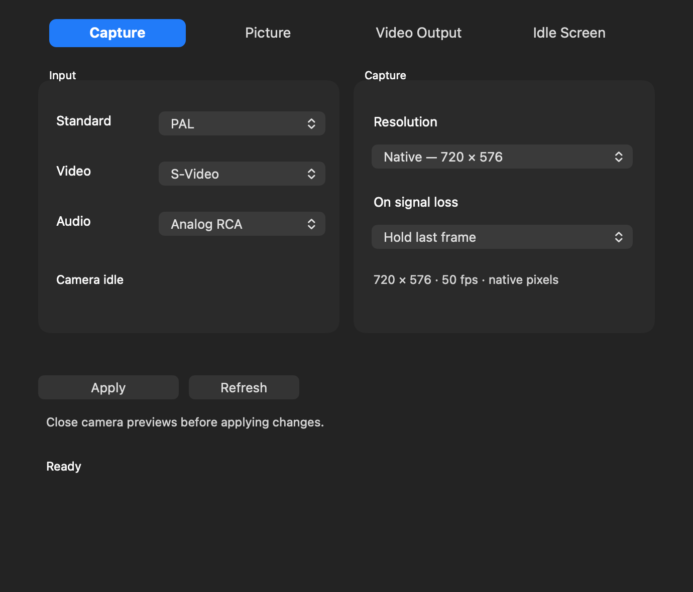
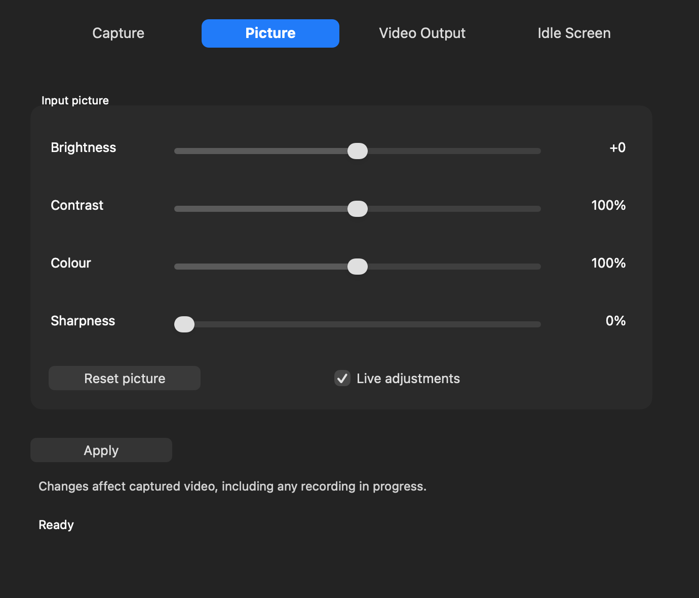
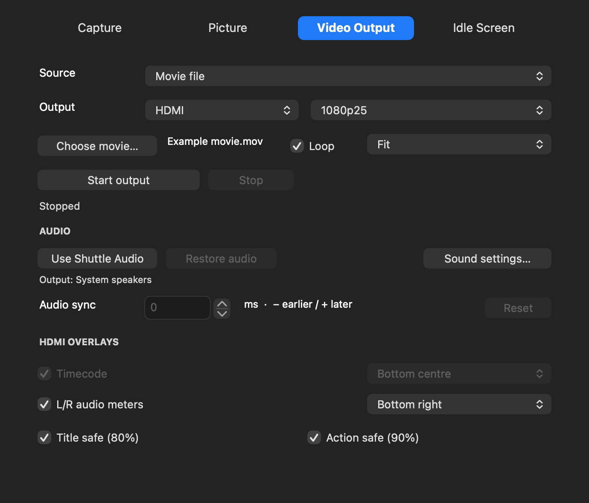
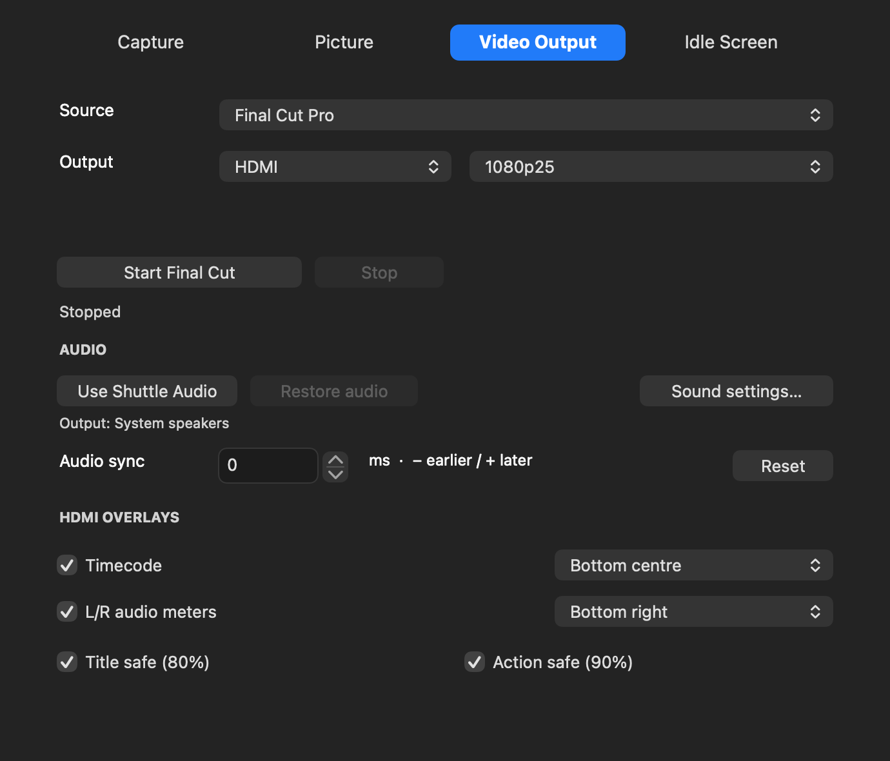
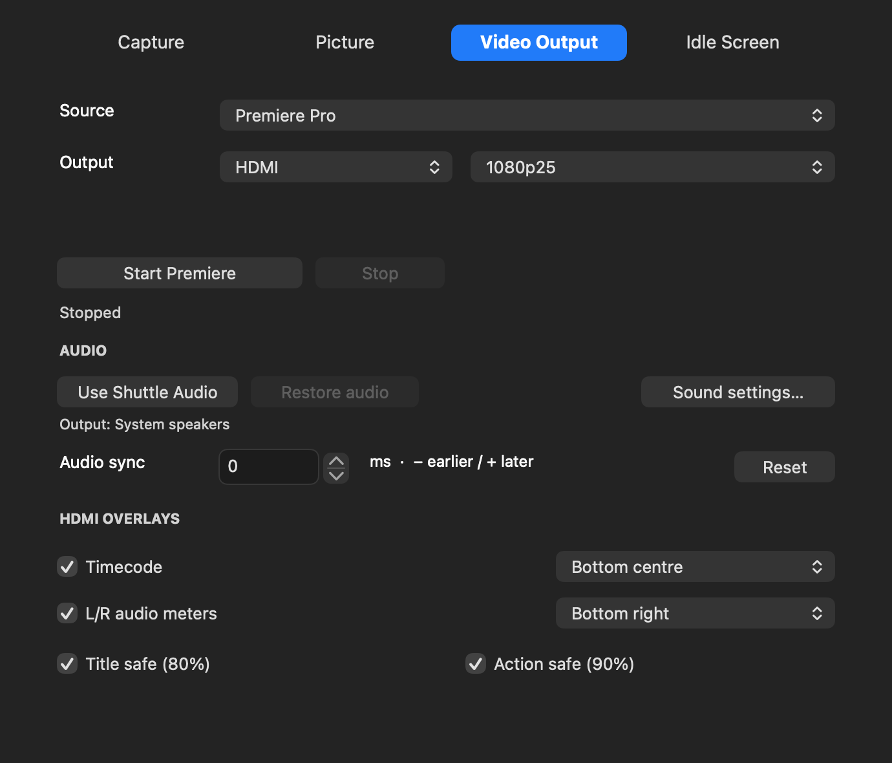
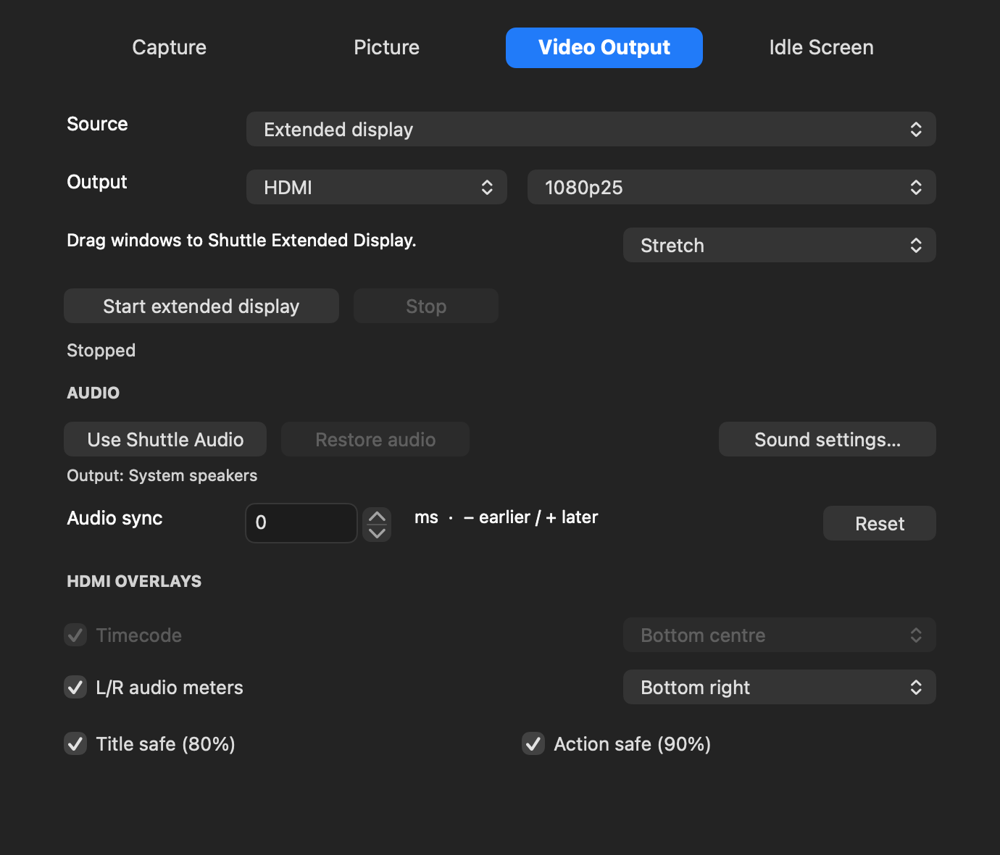
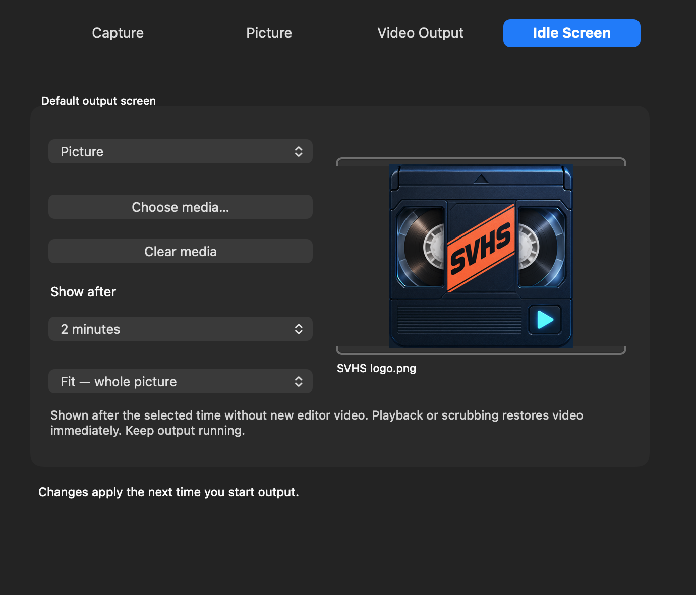

# Shuttle Camera 0.1.39 — Read Me

Installation & user guide · 18 October 2026

## Read this first

**Shuttle Camera 0.1.39** - Installation and user guide - 18 October 2026

Capture PAL/NTSC VHS, play movie files, monitor Final Cut Pro or Premiere Pro, and send a Mac desktop through the Intensity Shuttle USB 3.0.

> **Experimental development build.** The installer is unsigned; its components are ad-hoc signed and not notarized. The current installer requires SIP disabled. Read Security preparation before deciding to install. This is an independent project, not an official Blackmagic Design driver.

### Requirements

- Apple-silicon Mac and macOS 27 or later. Testing was on one Mac Studio with macOS 27.0.1; other machines/releases are not comprehensively qualified.
- Intensity Shuttle USB 3.0, working USB 3 cable/adapter, and administrator access. Intel Macs and the Thunderbolt Shuttle are not included.
- VCR with S-Video or composite and RCA stereo for tape capture. A compatible TV/monitor or recorder for playback.

### One device, two workflows

The Capture tab configures the camera feed; record with a separate camera app such as QuickTime Player. Video Output sends movies, editor frames or a desktop to the device. Capture and playback share the USB interface: use one at a time.

### What is new

Live input picture adjustments, capture-resolution retention, idle pictures/movies with a delay, connector-format choices, desktop mirroring, experimental extended display, and Stretch that follows live desktop resolution changes.

The following pages cover security, installation, capture, Picture, movie output, Final Cut, Premiere, desktops, scaling, idle screens, audio/overlays, troubleshooting and removal. Screenshots are current native app views rendered with demonstration settings. They contain no personal footage; selected values are examples.

## Security preparation

SIP protects macOS. Disabling it weakens protection across the Mac. Apple describes this as temporary development use; restore it after testing. [Apple: disabling and enabling SIP](https://developer.apple.com/documentation/security/disabling-and-enabling-system-integrity-protection).

### The tested development setup

1. Save work, back up important files and shut down. On Apple silicon, hold the power button until startup options appear. Choose **Options > Continue** and authenticate when requested. [Apple: Recovery on Apple silicon](https://support.apple.com/guide/mac-help/mchl82829c17/mac).
2. In Recovery choose **Utilities > Terminal**. Run the following, then restart into normal macOS.

```sh
csrutil disable
```

Check the status in normal Terminal:

```sh
csrutil status
```

The installer requires the fully disabled status; partial-disable combinations are not qualified. No supplied build script changes SIP. Building source alone does not require changing security.

### Extension developer mode

Apple describes developer mode as relaxing the location check for extensions loaded outside normal application directories. The supplied installer puts the host in Applications. For developers reproducing the outside-Applications build setup, the command is: [Apple: testing system extensions](https://developer.apple.com/documentation/driverkit/debugging-and-testing-system-extensions).

```sh
sudo systemextensionsctl developer on
```

This is separate from screen-recording permission. Do not use it as a generic fix for camera or microphone access.

### Restoration and limits

Use the removal/restoration steps at the end when finished. Continued operation after reenabling SIP has not been qualified for this ad-hoc build. This guide does not require disabling FileVault, authenticated-root protection or Gatekeeper globally, or enabling kernel extensions.

## Install and enable

1. Obtain **Shuttle-Capture-0.1.39.pkg** from a trusted project release. The GitHub source-code ZIP is not the installer. Compare its SHA-256 with the release checksums.
2. Disable editor external output. Stop capture/playback and quit Shuttle Camera, the editors and camera apps.
3. Open the package, check that its heading says **0.1.39**, and install on the current startup volume. Enter your administrator password in macOS when requested.
4. If macOS blocks an unsigned package, verify its source first. If you choose to proceed, use the specific package exception under Privacy & Security where offered; do not globally disable Gatekeeper. [Apple: opening apps safely](https://support.apple.com/en-gb/102445).

### First installation: enable the drivers

1. Open Shuttle Camera from Applications. Choose **Help > Driver Setup > Enable Camera**. For editor output, choose **Enable HDMI Output**.
2. Approve **Shuttle Camera Extension** and **Shuttle HDMI Output Extension** under System Settings > General > Login Items & Extensions > Camera Extensions.
3. Reopen Shuttle Camera and camera/editor clients after activation. Restart only if macOS requests it or the installed audio driver has not loaded.

An existing camera 17/output 12 installation does not need reactivation for this update. The installer backs up replaced bundles. An unchanged audio driver avoids a Core Audio restart; a first-time audio installation may briefly interrupt sound.

### Check the package

```sh
shasum -a 256 /path/to/Shuttle-Capture-0.1.39.pkg
```

Compare the whole result with the matching release SHA256SUMS.txt. A checksum verifies file identity, not publisher trust or notarization.

## Capture VHS



1. Connect VCR video OUT to the matching Shuttle input and red/white audio OUT to its RCA inputs. Connect USB 3 and play the tape.
2. Choose **PAL** or **NTSC**, the video input, **Analog RCA**, resolution and signal-loss behaviour. Close previews and click **Apply**.
3. In QuickTime choose **File > New Movie Recording**. Select the Shuttle camera and **Intensity Shuttle - Stereo Audio** microphone. Check picture, levels and a short recording before a long transfer.

PAL sizes: native 720x576, square 768x576, 1280x960 or 1440x1080. NTSC: native 720x480, square 640x480, 1280x960 or 1440x1080. Larger 4:3 sizes are scaled and add no tape detail. Bob deinterlacing gives 50 fps PAL / approximately 59.94 fps NTSC.

Hold last frame or Black preserves capture timing during signal loss; it cannot repair an unstable tape signal. Apply commits format changes. Refresh reloads the active camera settings.

## Live picture controls



1. Start the VCR and open the capture preview. In **Picture**, leave **Live adjustments** enabled.
2. Adjust **Brightness**, **Contrast**, **Colour** (saturation) and **Sharpness**. Watch the preview while moving a slider.
3. Use **Reset picture** for neutral processing. Check your recording before committing a long transfer.

These are software input-picture adjustments, applied to the camera feed rather than the tape. They do not control HDMI playback colour format. Changing video standard/input/resolution still needs Apply with previews closed.

If controls are unavailable, use Capture > Refresh. An older active camera extension may require activation with previews closed. Do not keep clicking Enable when the current driver is already ready.

## Movie playback and formats



1. Close camera previews. Select **Movie file**, click **Choose movie** and select an output connector and format.
2. Select sizing, enable **Loop** if desired and click **Start output**. Use Stop when finished. The movie supplies its own sound; Use Shuttle Audio is not required for it.

| Output format | Wire raster / cadence |
| --- | --- |
| PAL 576i50 | 720x576 / 50 fields per second |
| NTSC 480i59.94 | 720x486 / approximately 59.94 fields per second |
| 1080i50 /1080i59.94 | 1920x1080 / 50 or approximately 59.94 fields per second |
| 1080p25 /1080p29.97 | 1920x1080 / 25 or approximately 29.97 frames per second |

S-Video and composite use PAL/NTSC. HDMI/component keep supported SD/HD formats. Compatible connectors may remain active together; the selection constrains formats, not an exclusive switch. Separate HD-plus-downconverted-SD output is not implemented.

## Final Cut Pro output



1. Choose **Final Cut Pro** and a format appropriate to the timeline. Click **Use Shuttle Audio** if sound should follow the device.
2. Click **Start Final Cut** and wait for **Ready for Final Cut**. Keep Shuttle Camera open.
3. In Final Cut Pro 11, choose **Settings > Playback > A/V Output > Intensity Shuttle - HDMI Output**. Enable **Window > A/V Output** and play or scrub.
4. When finished, disable Final Cut A/V Output first, then Stop in Shuttle Camera. Turning A/V Output off alone does not restore the Mac sound route.

The Shuttle output is SD/HD, not 4K. Rendering/downscaling of a 4K timeline takes place in the editor. Compare the same section with A/V Output off if playback becomes choppy, and check timeline/output cadence before changing driver settings.

## Premiere Pro output



1. Choose **Premiere Pro** and the matching format. Click **Start Premiere** and wait for **Ready for Premiere**.
2. In Premiere Pro 2025 Playback settings enable **Mercury Transmit** and the video stream for **Intensity Shuttle - HDMI Output**.
3. In **Audio Hardware > Default Output** select **Intensity Shuttle - HDMI Audio**. The Transmit plug-in is video-only; an empty audio-stream column is expected.
4. Disable Mercury Transmit before stopping output. Restore any explicit Premiere audio-device selection inside Premiere itself.

Restart Premiere after plug-in installation. Its original Blackmagic Playback entry is separate from this project. If output disappears in the background, check Premiere's Disable video output when in the background option. Close one editor's external output before using another.

## Mirror or extend the desktop



1. Choose **Mac desktop** to mirror an existing screen, or **Extended display** for a separate desktop. Select connector, video format and sizing.
2. Grant **Screen & System Audio Recording** permission to Shuttle Camera in Privacy & Security when requested; reopen the app afterwards.
3. Start output. For Extended display, arrange **Shuttle Extended Display** in macOS Displays, then drag windows onto it. Use Shuttle Audio if Mac media sound should follow it.
4. Stop removes the virtual display and restores the saved audio route.

PAL/NTSC start with a 1024x768 desktop scaled to SD; HD starts with 1920x1080. macOS may offer other desktop sizes. The virtual desktop uses 60 Hz and is sampled into the selected video cadence. It is not a direct GPU monitor connection.

Extended display uses an undocumented macOS interface and may change after an OS update. Protected media may not be capturable. ScreenCaptureKit captures video here; audio uses the separate Core Audio route.

## Fit, Fill and Stretch

| Sizing | Result |
| --- | --- |
| Fit | Keeps the whole image and its proportions; adds borders when needed. |
| Fill | Fills without distortion by cropping the edges. |
| Stretch | Maps the whole image into the whole output frame; proportions can change. |

### Change desktop resolutions while output runs

1. Stop output and choose **Stretch** in Video Output, then start it.
2. Select the virtual/mirrored screen in macOS Displays and choose a desktop resolution. The whole current screen now fills the fixed video frame without restarting the sender.
3. For Fit/Fill, restart output after changing desktop resolution so their preserved-aspect geometry is recalculated.

Live software tests covered all eleven requested desktop sizes into HD, PAL and NTSC output surfaces: 1920x1080, 1600x1200, 1600x900, 1344x1008, 1344x756, 1280x960, 1280x720, 1024x768, 1024x576, 960x540 and 800x600. Available choices depend on the screen.

A 4:3 desktop stretched to 16:9 becomes wider. This is intentional Stretch behaviour. Desktop resolution, capture resolution and physical video timing are three different settings. Choosing a larger desktop does not add 4K or 1080p50/60 Shuttle wire output.

### Media and idle pictures

The same sizing choices are available for movie playback and idle pictures/movies. Restart output after changing idle sizing or media. The software accounts for PAL/NTSC pixel proportions when calculating Fit/Fill.

## Choose an idle screen



1. In **Idle Screen**, choose Hold last frame, Black, Colour bars, Picture or Movie loop (silent).
2. Use **Choose media** for a picture/movie. Choose Fit/Fill/Stretch and a **Show after** delay.
3. Restart output to apply the saved choice. Keep output running; playback or scrubbing restores new editor video immediately.

The default is two minutes without newly received editor frames. Delay choices are Immediately, 30 seconds, 1/2/5/10 minutes or Never. This replaces idle editor output, not a camera input-loss picture.

An idle movie loops silently. Keep the original movie file available at its saved location; an imported still is copied to Application Support. Missing/unreadable media falls back to black with a diagnostic.

## Sound, sync and overlays

| Task | Audio selection |
| --- | --- |
| Capture recording | Intensity Shuttle - Stereo Audio microphone |
| Final Cut / Mac media | Use Shuttle Audio in Shuttle Camera |
| Premiere monitoring | Intensity Shuttle - HDMI Audio in Audio Hardware |
| Movie playback | Sound from the selected movie file |

**Use Shuttle Audio** changes the Mac media output and saves its previous selection. Stop, helper exit or app quit restores it while the route is still the Shuttle; a later manual change is respected. Compatible device outputs can carry sound, though the Core Audio device keeps its existing HDMI Audio name. An explicit Premiere selection must be restored in Premiere.

### Timeline audio sync

Negative values move sound earlier; positive values delay it. Range: -100 to +500 ms, with 10 ms stepper increments. Press Return after typing a value and compare after about a second. Reset returns to zero. This is for timeline output, not capture recording; adjustments can briefly click or skip.

### Output monitoring aids

- **Timecode:** TC HH:MM:SS:FF, or a semicolon for drop-frame. Dashes mean the editor supplied no valid timecode.
- **L/R meters:** outgoing stereo levels, peak hold and clip indication.
- **Positions:** six choices each for timecode and meters, with independent placement. The timecode background is translucent.
- **Title safe 80% / Action safe 90%:** optional white/yellow guides. These are app guide percentages, not a broadcaster-compliance guarantee.

Overlays affect the outgoing picture on compatible outputs, not the editor project/source file. Output timecode is for editors; meters/guides also work with movie playback. About and Quit are in the app menu; Help contains setup, diagnostics and driver actions.

## Troubleshooting

| Symptom | Check |
| --- | --- |
| Installer error | Quit editors/camera apps and stop output. Confirm the installer heading/version; use the startup volume. Installer Log gives the actual failure. |
| Camera missing | Enable Camera in Help > Driver Setup and approve Camera Extensions; reopen the recording app. |
| No capture audio | Choose the separate Stereo Audio microphone, Analog RCA input and microphone permission. |
| Screen permission loops | Quit Shuttle Camera. Remove its old Screen & System Audio Recording entry, add /Applications/Shuttle Camera.app again, enable and reopen. Ad-hoc updates can leave an old permission signature. |
| SD screen absent in Displays | Select Extended display and Start. Use current software; PAL/NTSC now start at 1024x768. Test pattern does not create a desktop. |
| Only part of a desktop shows | Stop, select Stretch, start again. Stretch follows live desktop size changes; restart Fit/Fill after a mode change. |
| Editor output choppy | Match timeline/output cadence; compare A/V Output off/on. Check rendering/media load and collect diagnostics during the affected session. |
| Purple blacks on DVI monitor | The tested Dell P2213t needs YPbPr for HDMI-to-DVI. Selectable RGB output is not implemented. |
| Mac sound missing afterwards | Restore audio in Shuttle Camera or Sound settings; restore explicit Premiere output inside Premiere. |
| Premiere device absent | Restart Premiere and confirm the Transmit bundle is in the legacy Plug-ins path listed on the next page. |

For a report, include app/macOS/editor versions, project/source frame rate, output format, connection and relevant diagnostics. Review logs for personal filenames. Every codec, 4K timeline, analogue combination and long-session latency has not been comprehensively qualified. There is no Resolve output integration or simultaneous capture/playback.

## Remove it and restore security

1. Save work. Disable editor external output, stop playback/capture, restore sound and quit clients.
2. Use Help > Driver Setup > Disable Camera. Turn off both Shuttle Camera Extensions in System Settings.
3. Move Shuttle Camera.app from Applications to the Bin. Allow macOS to remove bundled extensions if prompted. Do not manually delete /Library/SystemExtensions.
4. In Finder, move only this project's audio driver and Premiere bundle at the paths below to the Bin. Administrator approval may be required. Restart to unload audio and finish pending removal.

### Installed components

- App: `/Applications/Shuttle Camera.app`
- Audio: `/Library/Audio/Plug-Ins/HAL/Shuttle Audio.driver`
- Premiere: `/Library/Application Support/Adobe/Common/Plug-ins/7.0/MediaCore/Shuttle/Shuttle Transmit.bundle`
- Source, status and backups: `/Library/Application Support/Shuttle Camera`. User settings/media are under the user's Library/Application Support/Shuttle Camera.

### Restore the development security settings

If developer mode was enabled, turn it off in normal Terminal:

```sh
sudo systemextensionsctl developer off
```

In Recovery Terminal, reenable SIP and restart. Verify with csrutil status in normal macOS. [Apple: disabling and enabling SIP](https://developer.apple.com/documentation/security/disabling-and-enabling-system-integrity-protection).

```sh
csrutil enable
```

The ad-hoc extensions may stop working with SIP restored; this runtime configuration is not qualified. Do not reset all system extensions, because that affects unrelated software. Keep backups until normal audio and files are checked.
